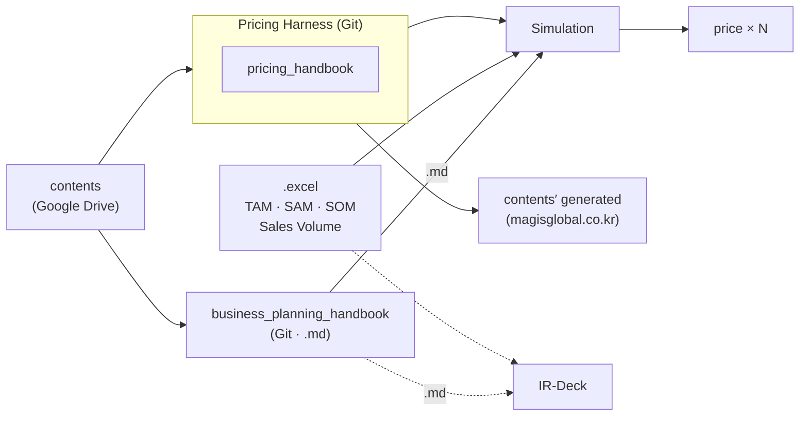

# Pricing Strategy Handbook v0.2 (English)

> [🇰🇷 한국어로 읽기](../ko/README.md) · [⬅ Back to main](../README.md)

## Purpose of This Handbook

A practical handbook that treats pricing not as a single number decision but as a structure connecting business model, customer value, competition, channel, cost, revenue model, and business feasibility. It combines a Knowledge Source (pricing-strategy theory) and a Tool Source (the Pricing Harness execution engine) into one canonical handbook.

## Target Audience

Corporate product-planning and merchandising (MD) staff, sales and marketing staff, and business-unit and strategy-planning staff. Consultants and business planners who want to learn pricing strategy systematically can read it too. No specific industry experience is assumed.

## Using This Handbook as a Corporate Training Course: Pricing Strategy Practice Course

The handbook serves as the textbook for the corporate HRD course **"Pricing Strategy Practice."** Each chapter is one 90-minute module, and the module number equals the chapter number (CH10 = M10). Every chapter opens with a "Training module M# · 90 minutes" label, and CH10–CH15 also link to the [Pricing Calculator](https://victory3217-bot.github.io/pricing-harness/calculator/?lang=en).

| Package | Duration | Modules |
|---|---|---|
| Pricing diagnosis lecture | Half day | M1 · M10 |
| Practice course | 1 day | M2 · M4 · M10 · M13 |
| Calculator intensive course | 1.5 days | M10 – M15 |
| Full course | 3 days | M1 – M15 |

- When a client's actual product data is used in worksheets or the calculator, the security scope is agreed in advance.
- Training proposal (PDF, Korean): [마지스글로벌_가격전략실무과정_제안서.pdf](https://www.magisglobal.co.kr/files/proposals/%EB%A7%88%EC%A7%80%EC%8A%A4%EA%B8%80%EB%A1%9C%EB%B2%8C_%EA%B0%80%EA%B2%A9%EC%A0%84%EB%9E%B5%EC%8B%A4%EB%AC%B4%EA%B3%BC%EC%A0%95_%EC%A0%9C%EC%95%88%EC%84%9C.pdf) (linked once the file is uploaded)
- Course information: [Magis Global handbooks](https://www.magisglobal.co.kr/en/handbooks/#course-pricing-strategy)

## Where This Handbook Sits

In this project, **Harness means the Pricing Harness only.** The handbooks are `.md` knowledge sources that feed it; they are not harnesses themselves.

## 3-Part Structure

### Part I — Pricing Strategy

- [CH01. Price Is the Outcome of the Business Model](chapters/CH01.md)
- [CH02. Cost and Cost Structure](chapters/CH02.md)
- [CH03. Two Logics of Pricing — Customer Value and Competition](chapters/CH03.md)
- [CH04. How Channel and Customer Relationship Reshape Price Structure](chapters/CH04.md)
- [CH05. Revenue Streams and Pricing Mechanisms](chapters/CH05.md)
- [CH06. The Three Financial Lenses and the Bridge to Business Feasibility](chapters/CH06.md)

### Part II — Feasibility Bridge

- [CH07. The Effective Market and My Market](chapters/CH07.md)
- [CH08. From Qualitative to Quantitative — Effective Market Sizing and P×Qty](chapters/CH08.md)
- [CH09. Interpreting QCD and Projected P&L, and Iterative Validation](chapters/CH09.md)

### Part III — Pricing Harness

- [CH10. MODE A — Current Price Diagnosis](chapters/CH10.md)
- [CH11. MODE B — Target Price Reverse Calculation](chapters/CH11.md)
- [CH12. MODE C — Allowable Cost Reverse Calculation](chapters/CH12.md)
- [CH13. BEP — Break-Even Point](chapters/CH13.md)
- [CH14. Scenario Compare](chapters/CH14.md)
- [CH15. Validating Price Hypotheses and Making Decisions](chapters/CH15.md)

## Worksheets / Examples

Every chapter includes one practical [worksheet](manual/) (15 total). [Examples](examples/) are included only where the source material (a Knowledge Module or a Pricing Harness CASE document) actually contains one (29 total: the original 13 plus 16 added from the Standard Lecture Plan 3-1) — no example was invented. Figures in the examples taken from the Standard Lecture Plan are practice-only hypothetical data and were verified by calculation. Each example can also be used as an exercise: first work through the "Exercise" (or "Think it through") yourself, then check it with "Show answer and walkthrough". The questions were built only from the example's own figures and wording. The examples are not published on the website; they live only in the `examples/` folder of this repository.

## Standard Lecture Plan 3-1 Enrichment

Each chapter (CH01–CH15) keeps §1–§9 unchanged and adds "10. Deep Dive: Standard Lecture Plan Enrichment" with the material the Standard Lecture Plan 3-1 decks added (supply and demand, price and channel structure, cost classification and allocation, three-case price structures, reading calculator status values, problem bank, and more), followed by a one-page summary card before §9. "Points that need confirmation" at the end of each section lists items the decks themselves did not confirm.

## Source Policy

This handbook combines two source types.
- **Knowledge Source**: the author's internal Knowledge Base (pricing-strategy theory)
- **Tool Source**: the Pricing Harness (a pricing-calculation and scenario-comparison engine)

No external research, web search, or general-knowledge supplementation was used. See [`../source-map.md`](../source-map.md) for the chapter-to-source mapping.

## Known Limitations (stated honestly)

A few chapters (CH03, CH05, CH15) include areas the source material or tool does not yet cover — rather than filling these gaps with unsupported content, the chapter states plainly "not yet defined / not yet implemented." See each chapter and [`../source-map.md`](../source-map.md) for details.

## Version

**v0.2** — v0.1 (Korean Private Release Candidate, human-reviewed and approved) plus the Standard Lecture Plan 3-1 layer (§10 per chapter, 16 examples, summary cards); the additions are not yet human-reviewed. This English edition is the direct, unabridged translation of the Korean edition.
