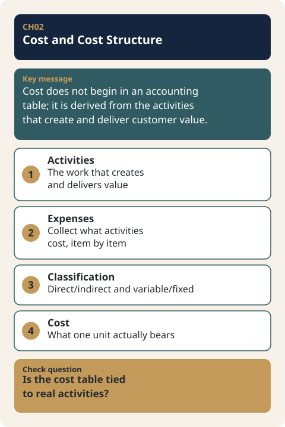

# CH02. Cost and Cost Structure

> **Presentation key message:** Cost is not a number that begins in an accounting table; it is the practical price floor derived from the activities required to create and deliver customer value.

## 1. Learning Objectives

Be able to apply the logic of how costs arise from activities, and distinguish between Fixed Cost, Variable Cost, Direct Cost, and Indirect Cost.

## 2. Core Concepts

Cost is the real-world constraint that must be checked first when setting a price. Even when pricing is set strategically, Cost still remains the constraint that functions as the realistic floor for price. In other words, no matter how sophisticated the pricing strategy, if the price continually falls below Cost, the business cannot survive.

The starting point for identifying Cost is not the accounting chart of accounts but actual activities. The approach is to first list out the activities the business must actually carry out — technology development, product manufacturing, sales and distribution, workforce operation — and then calculate what costs each of these activities requires. The costs derived this way can then be read through a few classification lenses: whether they occur at a constant level regardless of production volume (Fixed Cost) or change with production/sales volume (Variable Cost), and whether they can be directly traced to a specific product or service (Direct Cost) or are spread across multiple departments/products and are difficult to attribute (Indirect Cost). A manufacturing company calculates Manufacturing Cost by summing material cost, labor cost, and manufacturing overhead, while a distribution company uses the purchase cost of goods as its baseline; adding SG&A to either brings the figure close to Total Cost.

## 3. Why It Matters

How the cost structure is designed changes the business strategy itself. A business with high Fixed Cost struggles to survive unless it secures a certain level of sales volume, while a business with high Variable Cost must continually verify whether enough profit per unit remains even as sales volume grows. A product with high Manufacturing Cost prompts consideration of ways to reduce unit cost, such as cutting distribution stages or increasing production volume. In this sense, cost analysis is not a mere accounting exercise but a strategic filter that forces a fresh look at customers, channels, production methods, and sales volume.

## 4. Framework / Logic

The logic covered in this chapter proceeds in two stages.

First, the stage of estimating cost from activities. The activities the business must carry out are listed first. Technology development incurs costs such as research personnel, prototypes, materials, technology licensing, outsourced development, equipment, and information use. Producing a product requires materials, production personnel, leasing, outsourced processing, and transport/storage/packaging costs. Sales and distribution requires market research, securing distribution channels, advertising, exhibitions, samples, and sales personnel. The more concrete the execution details of the business plan, the more concrete the cost estimate becomes.

Second, the stage of reading the costs derived this way as a structure. Accounting draws a strict distinction between Cost and Expense, but what a business planner needs is not that strict distinction but the practical perspective of grasping the "total cost required to make, distribute, and sell the product." When that total cost is broken down along the two axes of Fixed Cost/Variable Cost and Direct Cost/Indirect Cost, it becomes clear which activities remain a burden regardless of sales volume and which activities can be attributed to a specific product.

## 5. Application Process

1. List the activities the business actually carries out, grouped as technology development, production, sales and distribution, workforce, etc.
2. List the detailed cost items required for each activity (personnel, materials, equipment, outsourcing, distribution, advertising, etc.).
3. Classify the listed cost items into Fixed Cost / Variable Cost.
4. Classify the listed cost items into Direct Cost / Indirect Cost.
5. For a manufacturing company, sum material cost, labor cost, and manufacturing overhead to derive Manufacturing Cost; for a distribution company, derive the purchase cost.
6. Add SG&A to arrive at a figure close to Total Cost.
7. Judge whether a profit can still be left after covering these activities and costs.

## 6. Applying This in Pricing or the Harness

The cost structure organized in this chapter (Fixed Cost, Variable Cost, Direct Cost, Indirect Cost, Manufacturing Cost, SG&A) becomes the direct input fed into the MODE A calculation of the Pricing Harness covered in Part III of this book. The detailed calculation logic of MODE A is not covered in this chapter; here, it is only noted that precisely classifying the cost items needed for that calculation is the precondition for the later stage.

## 7. Practical Checkpoints

- Did you start from actual activities rather than looking for costs in accounting accounts first?
- Is the execution content of the business plan concrete enough that the cost estimate is equally concrete?
- Have you identified whether the structure is Fixed-Cost-heavy or Variable-Cost-heavy?
- Have you distinguished Direct Cost from Indirect Cost to clarify which costs are attributable to a specific product or service?
- Have you added SG&A to Manufacturing Cost (or purchase cost) to arrive at a figure close to Total Cost?
- Have you examined how this cost structure affects pricing decisions and judgments on channel, production method, and sales volume?

## 8. Key Takeaways

Cost is the realistic floor for price, and Cost is derived not from accounting accounts but from actual activities. Costs derived from activities are read by classifying them into Fixed Cost/Variable Cost and Direct Cost/Indirect Cost, and Total Cost is grasped by adding SG&A to Manufacturing Cost (or purchase cost). Designing the cost structure is not an accounting exercise but a strategic filter that changes the business strategy itself.

## 9. Practical Questions

- What activities does our business actually carry out, and what costs does each activity require?
- What is the proportion of Fixed Cost versus Variable Cost in our cost structure?
- Have you distinguished costs directly attributable to a specific product/service from those that are not?
- Is the structure one in which per-unit profit is actually secured as sales volume grows?
- Can a profit still be left after covering this cost structure?

## 10. Deep Dive: Standard Lecture Plan Enrichment

### Cost and Expense: When They Arise and Where They Are Recorded

Cost arises in the process of acquiring resources, and expense arises in the process of using them. Manufacturing cost sits in inventory until the goods are sold, and after the sale it becomes an expense called cost of goods sold. For a distribution business, cost of goods sold is the purchase amount of the merchandise that was sold and passed to the customer. SG&A, the cost of selling and administrative activities, is recorded straight away as an expense of the period in which it was used.

| Category | When it arises | Where it is recorded |
|---|---|---|
| Manufacturing cost in a manufacturer | In the process of making the product | Inventory before sale; cost of goods sold after sale |
| Purchase cost in a distributor | When the merchandise is purchased | Inventory before sale; cost of goods sold after sale |
| SG&A | When resources are used for selling and administrative activities | An expense of that period |

So manufacturing cost is an inventoriable cost, and SG&A is a non-inventoriable cost (period cost). If 100 units are made and only 60 are sold, 60 units' worth goes into cost of goods sold, and the manufacturing cost of the remaining 40 units is not yet an expense but inventory. Conversely, a store clerk's monthly salary is that month's expense whether or not anything was sold.

### Separating Manufacturing Cost from SG&A: A Bakery Example

Manufacturing cost is the sum of materials, labor, and manufacturing overhead expenses, and SG&A is the cost of selling and administration (also called non-manufacturing cost). Where making ends and selling begins becomes clear with a bakery.

| Category | Manufacturing cost (making activities) | SG&A (selling and administrative activities) |
|---|---|---|
| Materials | Ingredients such as flour and eggs | — |
| People | A salaried baker | A salaried store clerk |
| Equipment and overhead | The oven that bakes the bread | Advertising in a local classifieds paper |

By industry, in a manufacturer the manufacturing cost becomes the cost of goods sold, the cost of the sales process is selling expense, and the cost of activities that manage the whole business is administrative expense. In a distributor, the purchase amount of the goods sold is the cost of goods sold, and operating expenses such as labor, depreciation, and supplies are divided into selling expenses and administrative expenses.

### Direct Costs, Indirect Costs, and Allocation

Direct costs are costs that can be separated out and traced to each cost object (a product, etc.), and indirect costs are costs that cannot be, because several products use them together. For indirect costs, first establish the total amount, then divide it among cost objects if needed; this is called allocation. Whether something is traceable depends not only on technical feasibility but also on the economics of tracing. If the effort of separating and tallying by product yields little, treat it as a common cost.

Dividing manufacturing cost into the six slots below reveals the direct and indirect costs. Manufacturing overhead is the sum of indirect materials, indirect labor, and indirect expenses.

| Slot | Meaning | Example |
|---|---|---|
| Direct materials | Principal materials easily separated by product | Steel plate, tires |
| Indirect materials | Materials hard to separate by product | Lubricant, solder |
| Direct labor | Wages of production workers on a specific product's production line | Production workers on a specific car line |
| Indirect labor | Wages of people who support the production of several products | Staff in purchasing, design, and materials-management departments; supervisors |
| Direct expenses | Expenses arising only for a specific product's production (the exception) | Outsourced processing fees, depreciation and repair costs of dedicated equipment |
| Indirect expenses | Expenses hard to separate by product (most of them) | Manufacturing expenses other than direct expenses |

Product cost differs depending on the basis used to divide indirect costs. The basis is chosen by the company, and there is no single correct answer. A hypothetical calculation dividing 1,000,000 KRW of manufacturing overhead by direct labor hours and by machine hours is in [CH02-EX01](../examples/CH02-EX01-overhead-allocation-basis.md).

### Per-Unit Cost and Profit Created by Variable and Fixed Costs

As the activity level (production or sales volume) rises, variable costs rise with it while fixed costs stay the same, so total cost per unit falls as quantity rises. The following is [Practice-only hypothetical data] with a variable cost of 3,000 KRW per unit and monthly fixed costs of 600,000 KRW.

| Quantity | Variable cost | Fixed cost | Total cost | Total cost per unit |
|---|---|---|---|---|
| 100 units | 300,000 KRW | 600,000 KRW | 900,000 KRW | 9,000 KRW |
| 200 units | 600,000 KRW | 600,000 KRW | 1,200,000 KRW | 6,000 KRW |
| 300 units | 900,000 KRW | 600,000 KRW | 1,500,000 KRW | 5,000 KRW |
| 400 units | 1,200,000 KRW | 600,000 KRW | 1,800,000 KRW | 4,500 KRW |

With a different cost structure, the shape of profit differs even at the same price. A comparison of two structures at a price of 6,000 KRW, as [Practice-only hypothetical data], follows.

| Structure | Cost | Contribution margin per unit | Break-even | Selling 100 units | Selling 400 units |
|---|---|---|---|---|---|
| A: large fixed cost | Fixed 800,000 KRW + variable 2,000 KRW/unit | 4,000 KRW | 200 units | -400,000 KRW | 800,000 KRW |
| B: large variable cost | Fixed 200,000 KRW + variable 4,500 KRW/unit | 1,500 KRW | about 133 units | -50,000 KRW | 400,000 KRW |

At 240 units the two structures earn the same profit (160,000 KRW each). Selling fewer than that, B is better; selling more, A is better. As explained in §3 of the main text, this shows in numbers that a business with large fixed costs feels more pressure to secure sales volume, while one with large variable costs needs closer attention to profit per unit. If the costs are hard to bear, go back to an earlier-stage choice among customer, channel, production method, sales volume, and price and look again.

### Classifying SG&A Accounts

The price management Excel files (manufacturing and distribution versions) split SG&A into labor costs, variable-cost expenses, and fixed-cost expenses for input. Variable-cost expenses are entered as a percentage of revenue (%), and fixed-cost expenses as a monthly amount.

| Category | Accounts | Input method |
|---|---|---|
| Labor costs (3) | Salaries and bonuses, four major social insurances, severance pay | Headcount and base salary |
| Expenses · variable costs (12) | Employee welfare, travel and transportation, entertainment, repairs, insurance, logistics (warehousing), supplies, commissions paid, rental fees, logistics (delivery), sales incentives, sales warranty | % of revenue |
| Expenses · fixed costs (15) | Communication, depreciation, rent paid, vehicle maintenance, ordinary R&D, education and training, books and printing, office supplies, advertising, sales promotion, bad debt, building management, amortization of intangible assets, miscellaneous, interest expense | Monthly amount |

The same account can be a variable cost at one company and a fixed cost at another. The Excel sheets consist of the estimated income statement, revenue, pricing, total cost, purchase cost (distribution version) or manufacturing cost and materials (manufacturing version), labor costs, and base data, and the cost table built in this chapter becomes the place where those inputs go.

### Moving Classification Results into Calculator Inputs

Accounting classifications and Pricing Harness input categories may have the same name but a different scope. In particular, the calculator's `variable_selling_delivery` (variable cost) means selling and delivery costs, while materials and packaging go into `product_service_direct_cost` (direct cost) (see CH10 §4).

| Accounting classification | Calculator input slot | Note |
|---|---|---|
| Materials, packaging | Direct cost | A variable cost in accounting, but not the calculator's "variable cost" slot |
| Parcel and delivery fees, card and channel fees | Variable cost | Selling and delivery costs only |
| Rent, regular labor, subscription fees | Monthly fixed operating costs | Not put into contribution margin; used in the break-even calculation (CH13) |

When entering, make sure not to put the same cost into two slots, to unify units, and not to leave out the owner's labor cost and rent. If a value is unknown, do not set it to 0; leave it as "unknown" and note how to confirm it (a quote, trial production, actual records). Entering an unknown cost as 0 produces a high margin with no basis (see CH10-EX02).

### Points that need confirmation

- The service industry's cost composition is presented only as a figure in the source, so it was not moved into a table in the main text.
- The correspondence table between accounting classifications and calculator input slots is an interpretation for organizing, and needs adjusting by industry and company.
- We could not confirm which standard document's estimated income statement the price management Excel connects to.

## Source Map

- MN: MN06
- KM: KM044, KM045
- SL: 3-1-05 (Cost theory: Zones A·B·C·D)
