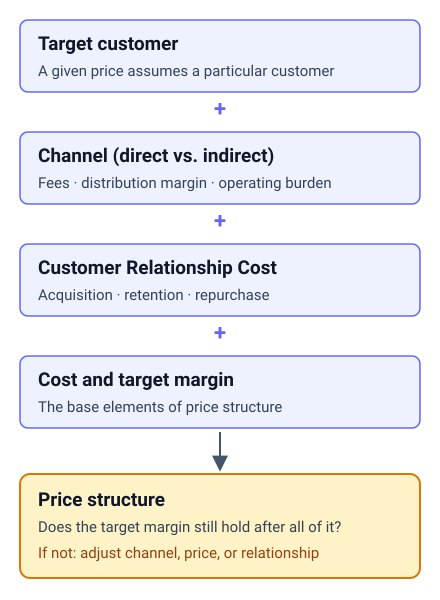
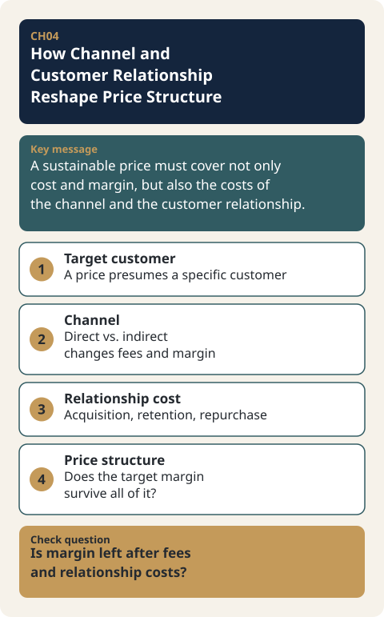

# CH04. How Channel and Customer Relationship Reshape Price Structure

> **Presentation key message:** A sustainable price must cover not only cost and margin, but also the costs of the channel and the customer relationship.

## 1. Learning Objectives

By the end of this chapter, you will be able to explain how channel type (direct vs. indirect) and Customer Relationship Cost (acquisition, retention, repurchase) affect price and margin structure.

## 2. Core Concepts

Price never moves on its own. A given price assumes a particular customer, assumes the channel used to reach that customer, and the fees and operating costs of that channel in turn reshape cost and margin. Using an indirect channel (distributors, platforms, consignment sales, etc.) gives access to a wider market, but it comes with distribution margin and fees. A direct channel (D2C, direct proposal-based sales, etc.), by contrast, can raise per-unit profitability, but it places the burden of acquiring customers and handling delivery and service on the business itself. Neither option is universally superior — the choice must be judged against the target customer, the nature of the product, available resources, and the desired pace of growth.

Price structure must account not only for channel cost but also for the resources needed to sustain the Customer Relationship. Customer relationship is not just courteous service. It is the set of activities that acquire customers, manage the purchase experience, and drive repurchase and additional purchases — and these activities require people, systems, and promotional spend. In other words, saying a revenue model is established means more than setting a single price tag: it means channel cost and Customer Relationship Cost have been considered together with cost and margin within the price structure.

## 3. Why It Matters

Setting a price without accounting for channel can create a structure where you lose money the more you sell. Once fees and distribution margin are subtracted, what actually remains in hand may not even cover cost. For the same reason, if Customer Relationship Cost (acquisition, retention, repurchase) is not reflected in the price structure, a price that appears to leave margin on the surface may in fact be unsustainable. Channel and customer relationship are distinct factors, but they share the same underlying principle: before asking "at what price should we sell," both force us to ask "to whom, through what path, and through what relationship is this price being delivered."

## 4. Framework / Logic

The logical structure shared by the two KMs is as follows.

1. Price is not a fixed number — it is a strategic variable continuously revised by other elements of the business model (customers, channel, production capacity, order volume, relationship cost, partners).
2. Channel choice (direct vs. indirect) creates a trade-off between market accessibility and per-unit profitability.
3. Customer Relationship Cost (acquisition, retention, repurchase) is a cost item that exists separately from cost and margin, and must be reflected together when designing price structure.
4. Even for the same product, if channel structure and Customer Relationship Cost change, the appropriate price and margin structure changes as well.

## 5. Application Process

1. Confirm the target customer and product characteristics, and list the channels (direct/indirect) available to reach that customer.
2. Check the fees, distribution margin, and operating burden for each channel.
3. Identify the activities required for customer acquisition, retention, and repurchase (people, systems, promotion) and their associated costs.
4. Review whether the target margin still holds once cost, channel cost, and Customer Relationship Cost are all reflected.
5. If it does not hold, decide what to adjust — channel composition, price, or how the customer relationship is operated.

## 6. Applying This in Pricing or the Harness

In the Pricing Harness (pricing-harness-public) tool, `core/schemas/client_input.schema.json` defines the fields `cost_item.applies_to_component` and `allocation_rule` at the schema level, which leaves structural room for allocating cost items by channel or component in the future. However, at the present time, no function actually calculates or analyzes channel-based cost allocation. In other words, these fields exist only in the input schema for now, and there is no analytical logic that uses them to automatically derive channel-based margin or fee impact. When applying the content of this chapter in practice, cost, fees, and Customer Relationship Cost by channel must currently be organized manually or in a separate spreadsheet, and the Harness should not be expected to automate this. This is a current limitation of the tool and should be recorded separately as an area requiring future development.

## 7. Practical Checkpoints

- Have channel-specific fees and distribution margin been confirmed before price design?
- Does the business actually have the customer acquisition, delivery, and service capability needed to operate a direct channel?
- Has the cost of people, systems, and promotion required for customer acquisition, retention, and repurchase been reflected in the price structure?
- Is there a process to revisit price when channel structure or order volume changes?

## 8. Key Takeaways

Price is not determined by cost and target margin alone. Only when channel fees, distribution margin, and the cost of sustaining the customer relationship are also reflected does a truly sustainable price structure emerge. Channel and customer relationship are the two axes that show price is a strategic variable requiring continuous review.

## 9. Practical Questions

- Through which channel (direct/indirect) is our product/service delivered to customers, and what is that channel's fee structure?
- How much does it actually cost to acquire customers and drive them toward repurchase, and is this reflected in the current price structure?

## 10. Deep Dive: Standard Lecture Plan Enrichment

### Terms and Equations of the Price Structure

Subtracting the discount program from the recommended consumer price (List price) gives the actual selling price (Sales price), and the Sales price splits into total cost and profit. Total cost in turn splits into SG&A and cost. That is, `Sales price = profit + total cost` and `List price = discount program + profit + total cost`. Read as relative proportions in the original diagram (List price = 100), it looks as follows.

| Item | Value (List price = 100) | Share of Sales price |
|---|---|---|
| List price | 100 | - |
| Discount program | 15 | - |
| Sales price | 85 | 100% |
| Profit | 10 | 11.8% |
| Total cost | 75 | 88.2% |
| SG&A | 40 | 47.1% |
| Cost | 35 | 41.2% |

The base of every ratio is always unified as the Sales price. The profit here is the value after subtracting SG&A as well, so do not mix its name with contribution margin, which subtracts only selling and delivery variable costs. If SG&A of 40 is split into variable 15 and fixed 25 (an assumption for explanation), then 85 − 35 − 15 = 35 is the contribution margin and 35 − 25 = 10 is the profit, so fixed costs show up separately. Moving the same structure into an income statement, the Sales price line becomes the first line of revenue. With a hypothetical unit price (List price 20,000 KRW, 500 units per month), the Sales price is 17,000 KRW, revenue is 8,500,000 KRW, gross profit is 5,000,000 KRW, and operating profit is 1,000,000 KRW. [Practice-only hypothetical data]

The structure can also be read backward. With a List price of 20,000 KRW, a 15% discount, and a target profit rate of 25%, the Sales price is 17,000 KRW, the target profit is 4,250 KRW, and the total cost available is 12,750 KRW. [Practice-only hypothetical data] For practice, see [CH04-EX05](../examples/CH04-EX05-price-structure-table.md).

### Sales Contract Types and Revenue Recognition

Even for the same 100 KRW sale, there is a type in which the entire sale price becomes revenue (outright purchase) and a type in which only the commission becomes revenue (consignment-type purchase). When comparing channels, you must align the revenue recognition basis, not just the price tag, before comparing ratios.

### Channel Structure and Margin by Stage

Channels divide into the path where the manufacturer sells directly to the buyer, the path through wholesale to retail, the path through an installer, and the clearance path for clearing out inventory. The Buyer may not be the same as the Consumer or the User. The manufacturer asks "at what price should we supply?", the distributor asks "at what price should we buy in?", and price is set where the two questions meet.

When a margin is added at each stage, the manufacturer's share becomes only a part of the consumer price. Assume a consumer price of 10,000 KRW, a retail margin of 30% (of retail price), and a wholesale margin of 15% (of wholesale selling price). [Practice-only hypothetical data]

| Stage | Selling price | Margin rate | Margin amount | Purchase price |
|---|---|---|---|---|
| Retail | 10,000 | 30% | 3,000 | 7,000 |
| Wholesale | 7,000 | 15% | 1,050 | 5,950 |

The manufacturer's supply price of 5,950 KRW is 59.5% of the consumer price. If the base of the margin rate (selling price basis or purchase price basis) is not unified, the calculation goes off. Even when the actors within a channel (a sales program, a creator) change, as in social media, the basic structure `price = discount program + profit + total cost` stays the same, and only the distribution share turns into a commission.

### Three Methods of Price Setting

| Method | What is fixed first | Gist |
|---|---|---|
| Cost plus | Cost | The manufacturer stacks SG&A and profit on top of cost to set the price |
| Sales minus | Positioning price | Subtract channel margin, profit, and SG&A from the price to obtain the allowable cost |
| Keystone | Multiplier of the distribution flow | In fashion, the price is set by a multiplier. The multiplier is not the same across industries |

Whichever method is used, it fills the same cells of the price structure in a different order. The key warning of Sales minus is "if sourcing is not possible at that cost structure, it cannot be sold." If the actual cost is higher than the allowable cost, choose among cost reduction, changing the composition, defending the price through differentiation, and revisiting the target rate. For calculation practice, see [CH04-EX04](../examples/CH04-EX04-channel-margin-sales-minus.md). The profit rate here is a simple calculation based on the Sales price (supply price).

### Comparing the Price Structures of the Three Cases

Recalculating the original diagram values of CH04-EX01 to EX03 with the Sales price set to 100% reveals the weight of the structure by transaction type. There is a difference of around 1% from the integer notation in the diagram.

| Item | B2C | B2B | B2G |
|---|---|---|---|
| List price → Sales price | 19,000 → 15,900 KRW | 1,500 → 1,250 KRW | 1,320,000 → 1,100,000 KRW |
| Manufacturing cost ratio | 56.6% | 66.6% | 30.9% |
| SG&A ratio | 15.0% | 9.0% | 30.0% |
| Total cost ratio | 71.6% | 75.5% | 60.9% |
| Margin rate | 28.4% | 24.5% | 39.1% |

B2C has a high manufacturing cost ratio, so it needed direct sales that cut the distribution steps. B2B has a low SG&A ratio, so economies of scale are the key. B2G has a high SG&A ratio, so the cost of relationships, trust, and procurement response is built into the structure. If B2B sells at the official supply price without a discount, the margin is 1,500 − 944 = 556 KRW, but after a 20% discount it is 306 KRW, a reduction of about 45%, so discounts should be tied to volume conditions.

### Promotion Fund: The Gap Between List Price and Sales Price

The promotion cost per unit is `List price − Sales price`, and the annual budget is this multiplied by the monthly production volume and 12 months (assuming everything is sold with no loss rate). B2C is 19,000 − 15,900 = 3,100 KRW, B2B is 1,500 − 1,250 = 250 KRW, and B2G is 220,000 KRW × 500 units × 12 months = 1.32 billion KRW (1,320,000,000 KRW). Funds that are not spent return to margin, so the customer-relationship fund must be set in advance within the price structure. For practice, see [CH04-EX06](../examples/CH04-EX06-list-sales-promotion-fund.md). Read it together with the existing cases [EX01](../examples/CH04-EX01-vegan-chocolate-d2c.md), [EX02](../examples/CH04-EX02-cosmetics-container-b2b.md), and [EX03](../examples/CH04-EX03-groundwater-b2g.md).

### Points that need confirmation

- Quoted or illustrative figures such as commission rates by store-entry contract type, Keystone multipliers, and channel margin rates are as of the time of citation or practice assumptions, not current conditions.
- The margin cell "330,000 KRW" in the B2G diagram does not match 110 − 67 = 43 (x 10,000 KRW), which looks like a notation error. The B2C CR cost of 3,180 KRW and 19,000 − 15,900 = 3,100 KRW also differ by 80 KRW.

## Source Map
- MN: MN06
- KM: KM048, KM049
- SL: 3-1-04 (Theory 2: Price Structure and Channel Structure), 3-1-06 (Three Cases), 3-1-09 (N-15 Questions 3-5)
