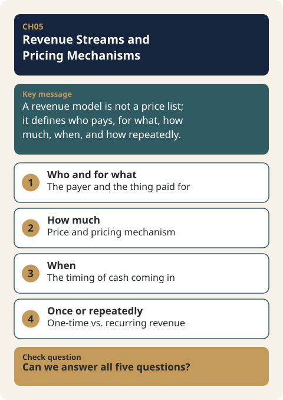

# CH05. Revenue Streams and Pricing Mechanisms

> **Presentation key message:** A revenue model is not a price list; it defines who pays, for what, how much, when, and how repeatedly.

## 1. Learning Objectives

After completing this chapter, you will be able to:

- Explain why Revenue Streams and Revenue Model are broader concepts than a single "price number."
- Distinguish the difference in economic resilience that One-time Revenue versus Recurring Revenue brings to a business.
- Reflect the actual way a price is charged — fixed price, negotiated price, volume-based price, bid/tender, and so on — in the design of a Pricing Mechanism.

## 2. Core Concepts

Deciding on a single price number does not, by itself, complete a revenue model. Even at the same price, the nature of the business itself changes depending on who pays, what they are paying for, whether they pay once or repeatedly, and whether the price is fixed in advance or shifts with negotiation and market conditions. A revenue model is a broader concept than the number called "price" — it must describe the structure that converts customer value into cash (KM050).

Borrowing Osterwalder's typology of Revenue Streams, revenue can be divided into categories such as asset sale, usage fee, subscription fee, lending/renting, licensing, brokerage fee, and advertising. This classification is useful when brainstorming new business ideas, but in practice what matters is not memorizing the names of the types. A single company can hold several revenue streams at once, and even the same product can use a different revenue structure depending on the customer segment and transaction terms (KM050).

Two more layers sit on top of this concept. First, there is the axis of whether revenue occurs once and ends there, or occurs repeatedly (KM051). Second, there is the axis of how that price is determined and charged — that is, whether it is a fixed price, or a price that varies with negotiation, volume, or bidding (KM052). Revenue Streams (what you are paid for) and Pricing Mechanism (how you are paid) are different questions, and designing a single revenue model requires addressing both together.

## 3. Why It Matters

Knowing only the names of Revenue Stream types makes it easy to lose sight of the actual customers and transaction structure (KM050). Repeat purchase or subscription is not always the right answer, but for a business carrying fixed costs, the economics of a structure that must constantly acquire new customers differ from those of a structure where existing customers generate revenue again (KM051). Price also does not exist only as a number fixed in advance. There are also variable prices that shift with the negotiating power of the parties, inventory, timing, supply and demand, and bidding conditions — and, particularly in B2B volume-based unit pricing or B2G procurement terms, the Pricing Mechanism itself is closely tied to the transaction relationship (KM052). Looking at these three elements separately makes it easy to narrow pricing down to the single question of "what number should we set," but in reality it is a compound design problem: who pays, for what, how much, when, and by what method.

## 4. Framework / Logic

A practical review of a revenue model can be compressed into the following questions (KM050).

- Who pays
- What are they paying for
- How much do they pay
- When does the money come in
- Do they pay once, or repeatedly

Once these questions are answered, the Revenue Stream type (asset sale, usage fee, subscription fee, lending/renting, licensing, brokerage fee, advertising, etc.) falls into place as a result. Starting by picking a type first reverses the correct order (KM050).

The last item on this list of questions — "do they pay once, or repeatedly" — becomes a judgment axis of its own. A model in which a product is sold once and the relationship ends there has a different economic resilience from a model in which Recurring Revenue is generated through an ongoing value proposition and relationship management after the purchase. When setting a price, you must look not only at the initial purchase price but also at the cost required to maintain the customer relationship and the potential for recurring revenue (KM051).

In addition, the question "how much do they pay" does not end with a single number. Whether that number is a fixed price, a negotiated price, a price that varies with volume, or a price determined through bidding gives the same product an entirely different transaction structure (KM052).

## 5. Application Process

1. For the target product/service, answer each of KM050's five questions one at a time (who, for what, how much, when, whether it repeats).
2. Based on the answers, sort out, as a result, which of Osterwalder's types (asset sale, usage fee, subscription fee, lending/renting, licensing, brokerage fee, advertising) the transaction falls under. Keep in mind that several Revenue Streams can apply to a single product at the same time (KM050).
3. Separate out the "pay once, or repeatedly" item and examine not just the initial purchase price but also the cost of maintaining the customer relationship and the potential for recurring revenue (KM051).
4. Re-examine the "how much do they pay" item from the standpoint of the Pricing Mechanism. Consider whether to go with a fixed price or a price that varies with negotiating power, inventory, timing, and supply and demand; for B2B, also consider volume-based unit pricing, and for B2G, procurement terms (KM052).
5. Synthesize the above into a single revenue model description covering who, for what, how much, when, whether it repeats, and the pricing method.

## 6. Applying This in Pricing or the Harness

The input schema of the Pricing Harness (pricing-harness-public), `core/schemas/client_input.schema.json`, already contains a `product.price_components[]` structure. In other words, the schema skeleton for accepting price input broken down by component already exists.

However, at this point in time, the tool does not yet have dedicated logic to distinguish and analyze the one_time / recurring / hybrid revenue model types covered in KM051. The schema field exists, but the capability to determine whether an entered price component is one-time, recurring, or hybrid, and to analyze the economics differently accordingly, has not been implemented. This is a current limitation of the tool, and it is left here as-is: a point where the tool's functionality has not yet caught up with this chapter's framework (KM050–KM052). Adding this capability in the future must go through a separate design and approval process (the Chapter 8 Workflow).

## 7. Practical Checkpoints

- Before setting a price number, did you first answer the five questions — who, for what, how much, when, whether it repeats?
- Did you arrive at the Revenue Stream type (asset sale, usage fee, subscription fee, etc.) as a result of answering those questions, or did you pick the type first (KM050)?
- Did you examine the potential for recurring revenue and the customer-relationship cost it requires together with the initial purchase price (KM051)?
- Did you clarify whether this transaction is a fixed price or one that varies with negotiation, volume, or bidding? In particular, if B2B volume-based unit pricing or B2G procurement terms apply, did you avoid leaving them out (KM052)?
- Did you confirm whether several Revenue Streams, or different revenue structures for different customer segments, apply to a single product at the same time (KM050)?

## 8. Key Takeaways

A revenue model cannot be reduced to a single price number. The questions of who, for what, how much, when, and whether payment repeats come before the Revenue Stream type (KM050). Recurring Revenue and One-time Revenue give a business different economic resilience, and price design must consider customer-relationship maintenance cost together with the potential for recurring revenue (KM051). Finally, price can be charged not only as a fixed number but through several mechanisms — negotiation, volume, bidding — and this mechanism itself is closely tied to the transaction relationship (KM052).

## 9. Practical Questions

- In the product/service you are currently reviewing, is the person who actually pays the same as the person who enjoys the value, or are they different?
- Does this transaction end after a single instance, or is there a possibility of repetition along with a relationship-management cost to sustain it?
- Is this price a fixed number, or can it vary with negotiating power, inventory, timing, supply and demand, or bidding conditions?

## 10. Deep Dive: Standard Lecture Plan Enrichment

### Applying the Five Questions in a Table

The five questions in §4 reveal what they mean for price design once you write them out in a table for a single product. Below is an example for a handmade rice cookie 6-piece set (selling price 15,000 KRW), which is [Practice-only hypothetical data]; adapt the answers to your own industry.

| Question | In the rice cookie case | What it means for price design |
|---|---|---|
| Who pays | The consumer who buys the set (the gift buyer and the person who eats it may differ) | If the person who pays differs from the person who enjoys the value, explain the value rationale from the payer's standpoint |
| What is paid for | A 6-piece cookie set (sale of goods) | The sales unit must be set first so that price, quantity, and cost can be aligned in the same unit |
| How much is paid | 15,000 KRW (whether VAT is included needs to be confirmed) | The amount left after deducting each channel's fees is the actual share |
| When does it arrive | At the time of payment | Write the timing of when the money comes in alongside the explanation of the revenue model |
| One-time or repeated | Repeated if there is repurchase, one-time if not | Look at the possibility of repurchase and the relationship-management cost it requires together with the first purchase price |

A price tag alone does not complete a revenue model. Answer the five questions first, and organize the revenue source type as a result of that. However, as stated in §6, the Pricing Harness does not yet have a function to analyze one-time and repeated transactions separately.

### Pricing Mechanisms by Transaction Type

When the transaction type changes, the way the price is determined also changes. Pricing mechanisms can be viewed as fixed price, negotiation, volume unit price, and bidding.

| Transaction type | Pricing mechanism | What affects the price | Handbook case |
|---|---|---|---|
| B2C | Fixed price is common (general expression) | The gap between consumer price and Sales price, and customer-relationship management such as discounts and gifts | [CH04-EX01](../examples/CH04-EX01-vegan-chocolate-d2c.md) Vegan chocolate D2C |
| B2B | Unit price varies with volume | Bulk order volume, intermediate distribution stages and fees | [CH04-EX02](../examples/CH04-EX02-cosmetics-container-b2b.md) Cosmetics container |
| B2G | Procurement conditions determine the price | Discounts, commissions, consignment sales fees, and the possibility of supply-price negotiation with distribution partners | [CH04-EX03](../examples/CH04-EX03-groundwater-b2g.md) Groundwater level measurement equipment |

The numbers for the three cases are covered in CH04 and CH08. Price is not only a number set in advance; it can vary with negotiating power, inventory, timing, supply and demand, and bidding conditions. Even for the same product, the transaction structure differs depending on which customer group it is sold to and through which mechanism, so when explaining a revenue model, write "how it is received" together with "how much."

### Points that need confirmation

- The expression "generally a fixed price" for B2C is a general description of the common case and is not a definition in the handbook body.
- The answers in the rice cookie cells are assumptions based on [Practice-only hypothetical data] and are not actual channel or market facts.

## Source Map

- MN: MN06
- KM: KM050, KM051, KM052
- SL: 3-1-01 (D5 Five Questions of the Revenue Model), 3-1-03 (D2 Transaction Type and Pricing Mechanism)
