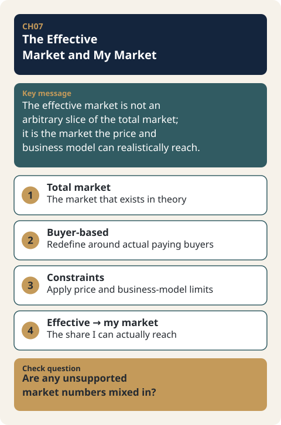

# CH07. The Effective Market and My Market

> **Presentation key message:** The effective market is not an arbitrary slice of the total market; it is the market the price and business model can realistically reach.

## 1. Learning Objectives

By the end of this chapter, readers will be able to distinguish the Total Market from the Effective Market (Addressable Market) as defined by the buyer, and explain how choices in the business model — including price — reshape the boundary of that market. Building on the assumption that the customer, value proposition, business model, price, and revenue model covered in Part I have already been made concrete, this chapter focuses on how those concrete choices determine the size and shape of "the market I can actually sell into."

## 2. Core Concepts

Feasibility is not about finding a large market. Reasoning such as "the total market is 100 billion won, and capturing even 1% of it yields 1 billion won" is closer to dressing up hope as a number than to answering why we can capture that 1% — which customers buy, for what reason, and at what price. Feasibility is the process of testing the logic of the business you have designed against real-world constraints and numbers, and listing TAM, SAM, and SOM before the business model and revenue model have been made concrete has little practical value.

The size of an entire industry and the market I can actually pursue are different numbers. For a resource-constrained startup in particular, the sheer size of the total market is not, by itself, grounds for calling a business a good one. What matters is identifying which part of that large market is actually reachable given the technology, resources, channels, cost structure — and price — that I have.

Another axis that divides the boundary of the market here is the definition of the buyer. A fundamental reason market size is hard to estimate is that the boundary of the market itself is not fixed. If we view the market as the set of actual and potential buyers, attention should focus not on the User but on the Customer — the one who pays. For the same product, who pays determines the unit and the data of the market. Sell directly to consumers and the buyer is an individual; supply to a distributor or manufacturer and the buyer becomes a company; sell into public procurement and the buyer becomes a government agency or local government. As the transaction relationship shifts among B2C, B2B, and B2G, the number of customers, purchase volume, price structure, channel, and decision-making conditions all change.

## 3. Why It Matters

Business planning is not the same as writing a business plan document. If the business plan document is the assembly of accumulated background data, business planning is the process of validating an idea, building a business model, and connecting the execution strategy to projected financials. Execution strategies — technology development, production, sales, workforce planning — ultimately have to flow into financial data such as manufacturing cost, SG&A, and revenue projections, and the effective market is the starting point of that connection.

When the market environment section of a business plan simply lifts the market size from a technology trend report, it is easy to mistake the total market for one's own market. The total revenue potential of the entire industry to which a technology could apply is different from the market for the specific product a given startup can actually make and sell. Once this distinction is made clear, market size becomes a decision-making tool rather than a promotional number. The total market is the starting point for understanding the external environment and opportunity; the effective market is the result of the choices made about product, customer, price, channel, and resources. Market size, therefore, should not be treated as a number written once at the start of business planning, but as a variable that changes every time the business model is revised — especially every time the price changes.

Before calculating the effective market, one must first distinguish who is the user, who is the buyer, and who approves the budget. Without this question, the very data used to calculate market size is chosen incorrectly. Estimating the effective market is, before it is a technique for calculating market size, a process in which the entrepreneur strategically defines the boundary of the market.

## 4. Framework / Logic

The market must be viewed from two directions at once. One is the Top-down view, which works down from the industry; the other is the Bottom-up view, which works up from the customer's actual purchasing possibility. Top-down is used to understand the external environment and the opportunity across the whole industry; Bottom-up is used to confirm the set of customers actually reachable through the combination of product, price, channel, and resources one has designed. Neither view alone can define the effective market.

Price is the parameter that connects these two views. Even for the same product, how the price is set changes the range of buyers who can afford it — that is, the boundary of the buyer-defined market. Lower the price and individual consumers can enter the market; raise it and only organizations or institutions with budget and decision-making authority may remain. Conversely, when the buyer shifts to an organization, as in B2B or B2G, the price structure, channel, and decision-making conditions themselves change, which in turn changes the range of achievable prices. In other words, a circular relationship holds: price defines the buyer, and the definition of the buyer in turn defines the boundary of the market.

This process is not a linear calculation done once and finished. Estimating the effective market is a process that gets readjusted through staged validation, and the scope of the effective market must be redrawn every time the business model or the price changes.

## 5. Application Process

1. Grasp the size and trends of the Total Market (Top-down) to understand the industry's opportunities and constraints.
2. Distinguish between the person who actually uses the product (User) and the person who pays for it (Customer).
3. Determine whether the buyer is an individual, a company, or a government/local government (B2C/B2B/B2G), and organize how the number of customers, purchase volume, and decision-making conditions change accordingly.
4. Based on the currently designed price, channel, and cost structure, calculate the actually reachable set of buyers (Bottom-up).
5. Compare the Top-down and Bottom-up numbers to check whether the business logic you designed can pass under real-world constraints and resources.
6. Whenever the price, channel, or buyer definition changes, repeat steps 4–5 to readjust the effective market.

## 6. Applying This in Pricing or the Harness

The boundary of the effective market laid out in this chapter — particularly the logic of how price changes the range of buyers — feeds into the break-even point (BEP) calculation and Scenario Compare inputs of the Pricing Harness covered later in Part III. Whenever the effective market is redefined more narrowly or more broadly, the break-even sales volume and the revenue estimates for each scenario change along with it, so the procedure in this chapter is a precondition for the calculations covered in the following chapters. The specific calculation method is addressed there.

## 7. Practical Checkpoints

- When citing a market size figure, have you distinguished whether it is a Total Market (Top-down) number or an Effective Market (Bottom-up) number?
- Does reasoning like "we only need to capture a few percent" skip the actual evidence on customers, price, and channel?
- Have you clearly distinguished the User from the Customer?
- Depending on whether the buyer falls under B2C, B2B, or B2G, have you re-examined the price structure, channel, and decision-making conditions?
- When you changed the price, did you also recalculate the scope of the effective market?
- Are you listing TAM, SAM, and SOM before the business model and revenue model have been made concrete?

## 8. Key Takeaways

The effective market is not an artificial slicing of the total market figure; it is the calculation of the realistic territory that remains after passing through the constraints of the business model. This calculation requires using the Top-down and Bottom-up views together, and at its center are the questions "who is the user and who is the buyer" and "what price can that buyer afford to pay." Price changes the range of buyers, and the range of buyers in turn changes the boundary of the effective market. The effective market is therefore not a number fixed once at the start of a business, but a living variable that must be recalculated every time the price and the business model change.

## 9. Practical Questions

- Is the market size I am presenting right now the entire industry's figure, or the figure actually reachable through my price, channel, and resources?
- Are the user and the buyer of this product the same person, or different people?
- Does the buyer fall under individual, company, or government, and have you designed the price and channel differently accordingly?
- If you changed the current price, would the boundary of your effective market widen or narrow?

## 10. Deep Dive: Standard Lecture Plan Enrichment

### Checking Market Statements That Skip the Evidence

Market statements usually have missing evidence. The table below lays out what evidence and questions common statements need.

| Common statement | Missing evidence | Question needed |
|---|---|---|
| The total market is 100 billion KRW, and even 1% is 1 billion KRW | Why can that 1% be captured? | Which customers buy, for what reason, and at what price? |
| The market is big, so it is a good business | The technology, resources, channels, and cost structure I have | Which part of that market can I actually reach? |
| List TAM, SAM, and SOM first | Making the business model and revenue model concrete | Have price, channel, and revenue model been decided? |

### Count the Market by Buyer

Count the market by the buyer who pays, not by the person who uses. The buyer, the user, and the budget approver can be different people.

| Transaction type | Buyer who pays | Person who uses | Market unit and data |
|---|---|---|---|
| B2C | Individual consumer | Usually the same person | Number of customers, purchase frequency |
| B2B | Distributor or manufacturer (organization) | Internal staff in the company, end consumer | Order size, production output of the downstream industry |
| B2G | Government agency or local government | Field-level department | Budget line item, legal obligation, number of agencies |

The "Person who uses" column spells out the explanation in the body text.

### Effective Market Calculation That Changes with Price

Lowering the price brings individual consumers into the market, and raising it leaves only customers who can afford to pay. Assuming the number of customers able to buy ([Practice-only hypothetical data]) and calculating the market by price (one unit per person) gives the following.

| Price | Customers able to buy (assumed) | Effective market (P × Qty) |
|---|---|---|
| 10,000 KRW | 120,000 people | 1.20 billion KRW |
| 20,000 KRW | 70,000 people | 1.40 billion KRW |
| 40,000 KRW | 25,000 people | 1.00 billion KRW |

The market is largest at a price of 20,000 KRW (1.40 billion KRW), and raising the price beyond that, the drop in customers outweighs the rise in price. The customer numbers are explanatory assumptions, not an actual demand function. The buyer range must be recalculated every time the price changes, and the actual figures are confirmed through customer research and market response.

### Comparing the Top-down Number and the Bottom-up Number

Place the two numbers side by side and explain the difference. An example ([Practice-only hypothetical data]) is as follows.

| Category | Calculation | Value |
|---|---|---|
| Top-down: whole product-category market (assumed) | Figure from market research data | 60 billion KRW |
| Bottom-up ① Own online store | 20,000 reachable customers × 3 times a year × 15,000 KRW | 0.90 billion KRW |
| Bottom-up ② Listed channel | 40,000 reachable customers × 2 times a year × 15,000 KRW | 1.20 billion KRW |
| Bottom-up total | ① + ② | 2.10 billion KRW (3.5% of Top-down) |

The 3.5% is not a target ratio of "let's capture this much"; it is a result built up from channels, price, and resources. The difference between the two numbers is a constraint created by my price, channels, and resources, so those factors must be explained, and each number carries a source or an "assumption" label.

### Market Boundary Memo

For your own business, write down the following items on a buyer basis.

| Item | What to write |
|---|---|
| User and buyer | Who uses it and who pays? |
| Transaction type | B2C, B2B, or B2G? |
| Number of customers and purchase quantity | What is the supporting data? |
| Price structure, channel, and decision conditions | What differs by transaction type? |
| Top-down and Bottom-up | The two numbers and their sources |
| Difference between the two numbers | The factors that created the difference |
| When the price changes | Does the market boundary widen or narrow, and why? |

### Points that need confirmation

- The customer numbers by price and the Top-down/Bottom-up numbers are all practice assumptions. Actual demand must be confirmed through customer research.

## Source Map
- MN: MN07
- KM: KM055, KM056, KM057
- SL: 3-1-07 (Financial lenses and effective market: market calculation by price, Top-down/Bottom-up comparison, market boundary memo)
