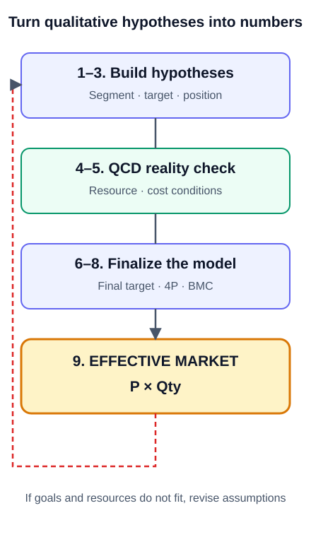
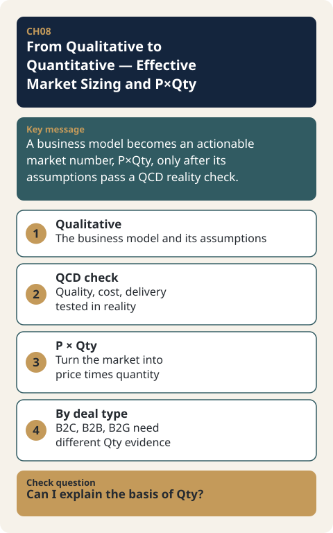

# CH08. From Qualitative to Quantitative — Effective Market Sizing and P×Qty

> **Presentation key message:** A business model becomes an actionable market number, P×Qty, only after its assumptions pass a QCD reality check.

## 1. Learning Objectives

By the end of this chapter, you will be able to convert a qualitative business model into quantitative inputs, and estimate the effective market by building the rationale for Qty (units sold) differently depending on the transaction type — B2C, B2B, or B2G.

## 2. Core Concepts

The Business Model Canvas (BMC) is a useful tool for connecting customers, value proposition, channels, customer relationships, key resources, key activities, partnerships, cost structure, and revenue streams at a glance. But writing customers and a value proposition on sticky notes alone cannot tell you whether the business actually works. A real business must be able to explain how much revenue is generated when a specific quantity is sold at a specific price, and how much is left over after subtracting the costs required to generate that revenue.

If the BMC is reinterpreted so that it connects to a projected income statement, price and quantity must be worked out to estimate revenue, and key activities and cost structure can be used to estimate the costs the business incurs. A BMC reinterpreted this way stops being merely a canvas for organizing qualitative ideas and becomes a blueprint that links an executable business plan to financial outcomes.

The concrete procedure through which this qualitative-to-quantitative conversion actually happens is the 9-step effective market sizing process, and its final output is the effective market size, expressed in the simple form of price (P) × units sold (Qty). Although the formula itself is simple, the way P and Qty are determined differs by transaction relationship (B2C, B2B, B2G).

## 3. Why It Matters

The most important turning point in the qualitative-to-quantitative conversion is the cost review step. The steps before it are relatively qualitative, focused on building out the concept and scenario; the steps after it carry a heavier weight of quantitative review. If the calculated costs turn out to be unaffordable, the customer, product spec, price, and channel chosen earlier must be revisited and changed. In other words, the numbers are not simply written down as a final result — they play a feedback role that sends you back to revise the strategy set in the earlier steps.

This principle matters because, no matter how compelling the qualitative story is, if the effective market expressed as P×Qty does not match the business goals or resource conditions, the business model cannot be executed as it stands. Effective market sizing is not a matter of arbitrarily carving off some percentage of the total market — it is the work of expressing the market as a number that reflects verified conditions for customers, price, channel, and resources.

## 4. Framework / Logic

Effective market sizing consists of a 9-step process of iterative verification. The purpose of the 9 steps is not simply to fill out a checklist. The purpose is to set an idea and a market hypothesis, pass it through the real-world filters of resources and costs, revise the customer, price, and business model again as needed, and ultimately express the result as a single number: the effective market.

**Steps 1–3: Build the hypothesis.** Starting from the idea and environmental analysis, the total market is segmented and a target segment is selected. Positioning toward that target customer is then defined, followed by hypotheses about the distribution and pricing needed to realize it. The output of this stage is not yet a finalized business model — it is a hypothesis to be tested.

**Steps 4–5: Check reality with QCD.** This stage consists of Step 4 (available resource review) and Step 5 (input cost review), and checks whether the hypothesis built in Steps 1–3 is actually executable given real resource and cost conditions. Depending on the outcome of this review, the hypothesis or the business model in the later steps may need to be adjusted again.

**Steps 6–8: Narrow down to an executable model.** Reflecting the results of the QCD review, the final targeting is confirmed, final positioning and the 4Ps (Product, Price, Place, Promotion) are set, and the final BMC is determined on that basis. The output of this stage is not a hypothesis but a business model whose feasibility has been verified.

**Step 9: Finally, express the market as a number.** Based on the finalized business model, the effective market size is estimated. This number is not some percentage of the total market — it is the result of the customer, price, channel, and resource conditions verified through Steps 1–8. If the size derived in Step 9 falls short of the business goals or does not fit the resource conditions, you go back to the earlier steps and readjust the hypothesis and the model.

Each of the 9 steps is not a linear procedure passed through once in order — it has an iterative structure in which the results of later steps loop back and are reexamined against the earlier steps.

## 5. Application Process

The final output of the 9 steps, the effective market size, is expressed as price (P) × units sold (Qty). While the form is the same, the basis and method for deriving Qty differ by transaction type.

**B2C.** Because the buyer is an individual consumer, "at what price will how many people buy how often" becomes the core logic explaining Qty. The effective market size is calculated by combining the product price, the number of target customers, and annual consumption volume.

**B2B.** Price and quantity are not independent of each other — they move together depending on order size and production method. It is common for unit price to vary with order volume, and for the target margin to be achievable only by lowering fixed costs through bulk orders. Rather than directly multiplying by the number of consumers, the effective market size may instead use a top-down approach that draws on the production output of upstream industries.

**B2G.** The buyer is a public institution, and procurement volume is affected by government budgets and legal obligations. Even if you calculate equipment price multiplied by the number of potential installation targets, the result cannot exceed the budget range that can actually be executed in the public market. Qty for B2G is not simply the number of institutions — it depends on whether there is a legal obligation to install or manage the equipment, the budget line item and its size, and whether the approach is direct sales or a partner channel. In the public market, institutions and budgets act as an additional constraint that defines the market size.

What matters in effective market sizing, then, is not applying a single formula uniformly to every business, but first determining who the buyer is and what data explains demand.

## 6. Applying This in Pricing or the Harness

The P×Qty logic covered in this chapter is the direct conceptual foundation for the break-even point (BEP) calculation covered later in this handbook's Pricing Harness. Only when price (P) and units sold (Qty) can be derived with a rationale can revenue be estimated, and only with that revenue estimate can break-even be calculated together with the cost structure. The specific method for calculating BEP is covered in a later chapter.

## 7. Practical Checkpoints

- If you have organized your business model using the BMC, check whether each element can be explained in terms of revenue from a specific price × quantity and the corresponding costs.
- If the input cost review turns out to be unaffordable, do not simply accept the cost as given — go back and readjust earlier choices such as customer, product spec, price, and channel.
- Check whether you are estimating the effective market size as an arbitrary percentage of the total market rather than going through the full 9 steps.
- Before building the rationale for Qty, first clarify the transaction type (B2C/B2B/B2G) and use the data appropriate to it (number of customers and consumption frequency; order size and production output; budget and legal obligations).
- If the effective market size derived in Step 9 falls short of the business goals or resource conditions, do not stop at the final step — go back to the earlier steps and readjust the hypothesis and the model.

## 8. Key Takeaways

A business model should not remain a qualitative concept — it must be explainable in terms of the revenue and costs generated by a specific price × quantity. The turning point of this conversion is the input cost review, and the numbers play a feedback role that sends you back to reexamine the strategy set in earlier steps. This conversion happens through the iterative 9-step effective market sizing process (build hypothesis → check reality with QCD → finalize the model → estimate the effective market size), and its final result is expressed as P×Qty. While the form of P×Qty stays the same, the basis for Qty must be built differently depending on transaction type: B2C (number of customers × consumption frequency), B2B (order size and production output), and B2G (budget and legal obligations).

## 9. Practical Questions

- Is our business's effective market size a number that came out of the full 9-step process, or an arbitrary percentage of the total market?
- If the input cost review turns out to be unaffordable, which earlier step (customer, product, price, channel) will you readjust first?
- Which of B2C, B2B, or B2G is our transaction type, and do we actually have in hand the corresponding basis for Qty (number of customers and consumption frequency, order size and production output, or budget and legal obligations)?

## 10. Deep Dive: Standard Lecture Plan Enrichment

### Reading the 9-Step Diagram

The diagram in the 2023 Pricing Management lecture plan divides the process of estimating effective market size into five segments: hypothesis building, feasibility review, product planning, BM finalization, and effective market size estimation. Vertically, it moves from the early steps with a high qualitative weight (Steps 1–3) to the later steps with a high quantitative weight (Step 4 onward); horizontally, the nine BMC blocks (CS, VP, CH, CR, KR, KA, KP, Ct, RS) are filled in at each step. The note on the right lists the output for each group of steps (business strategy formulation, business model brainstorming, pivoting and business plan formulation, final business model summary, effective market size calculation).

### Questions by Step and Where to Return

| Step | Core question | Where to return if stuck |
|---|---|---|
| 1. Idea and environment analysis | What idea did we start from, and what is the market environment? | — |
| 2. Segment decision and targeting | By what criteria do we divide the market, and which segment do we target? | — |
| 3. Positioning, distribution, and price (hypotheses) | What are the positioning, distribution, and price hypotheses aimed at the target customer? | — |
| 4. Available resource review (Q·D) | Do we have the resources to make the required level of quality, and the resources to sell and deliver? | Step 2 or 3 |
| 5. Input cost review (C) | Is the concrete plan to make and sell the product, and its cost, affordable? | One of Steps 2, 3, 4 |
| 6. Final targeting | Reflecting the QCD review, which segment do we finally target? | — |
| 7. Final positioning and 4P | What are the final positioning and the product, price, distribution, and promotion? | — |
| 8. BMC decision | Are the BMC components organized so that a 1–3 year projected income statement can be derived? | — |
| 9. Effective market size estimation | With the finalized BM, what is P × Qty? | Table below |

Step 8 asks, in particular, what the sales target quantity is for price × the customer segment decided to be pursued. The Step 9 result is compared against the following criteria.

| Step 9 result | Criterion to compare | Where to return if it does not fit |
|---|---|---|
| Effective market P × Qty | Business goals (sales and profit targets) | Step 3 price and distribution hypotheses, Step 2 targeting |
| Effective market P × Qty | Resource conditions (production, staff, channels, budget) | Steps 4 and 5 resource and cost review |
| Basis of Qty | Is there data by transaction type? | Steps 1–2, supplement market data |

### One-Line Example of the 9 Steps: Handmade Rice Cookies

This is [Practice-only hypothetical data]. The number of target customers and purchase frequency are assumptions, not actual demand evidence. Steps 4–5 use numbers from the price-verification calculation (CH10 and CH13).

| Step | One line |
|---|---|
| 1 | Opportunity in the gift-oriented handmade snack market (assumed) |
| 2 | Of gift and snack demand, target online gift buyers |
| 3 | Sincere gift cookies, 15,000 KRW, online direct sales (hypothesis) |
| 4 | Producible 250 sets per month (kitchen and staff) |
| 5 | Direct cost 6,000 KRW + variable cost 3,750 KRW, monthly fixed costs 600,000 KRW |
| 6 | Finalized as online gift buyers |
| 7 | Set of 6, 15,000 KRW, own online store and social media, gift message |
| 8 | One BMC that can produce the projected profit and loss |
| 9 | 15,000 KRW × 8,000 target customers × 3 times a year = 0.36 billion KRW |

### Qty Evidence Table by Transaction Type

Dividing the three transaction types of §5 into cells shows where the basis for Qty comes from. The hypothetical example is [Practice-only hypothetical data].

| Item | B2C | B2B | B2G |
|---|---|---|---|
| Buyer | Individual consumer | Company (ordering firm) | Government agency or local government |
| P | Generally a fixed price (rice cookies 15,000 KRW) | Unit price that varies with order quantity (volume-tier price table) | Equipment or service price (5,000,000 KRW) |
| Qty basis 1 | Number of target customers (8,000 people) | Order size (the larger it is, the lower the fixed cost per unit) | Number of potential installation targets and legal obligation (1,200 sites, 6 billion KRW) |
| Qty basis 2 | Annual purchase frequency (3 times a year) | Production output of the downstream industry (400 billion KRW × segment ratio 8% = 32 billion KRW) | Budget line item and size (total budget 1.2 billion KRW) |
| Additional constraint | Definition and year of the population statistics | Own production capacity limit, collaborative production partner | Approach method (direct sales, partner channel) |
| Output | 15,000 × 8,000 × 3 = 0.36 billion KRW | 32 billion KRW | min(6 billion, 1.2 billion) = 1.2 billion KRW |

In the B2G hypothetical example, equipment at 5,000,000 KRW × 1,200 sites is 6 billion KRW, but if the budget that can be executed is 1.2 billion KRW, the market is limited to 1.2 billion KRW, about 240 units. The calculation is practiced in [CH08-EX03](../examples/CH08-EX03-b2g-budget-cap.md). When writing the evidence table, decide the transaction type first, mark every number with a source or "assumption", and note the cap or risk. Do not use an arbitrary percentage of the total market.

### Points that need confirmation

None. However, the rice cookies and the numbers in the hypothetical examples are all [Practice-only hypothetical data] meant to practice the structure, not actual market facts.

## Source Map

- MN: MN07
- KM: KM058, KM059, KM062
- SL: 3-1-08 (P×Qty 9 steps: diagram commentary, rice cookie 9 steps, Qty evidence table by transaction type)
