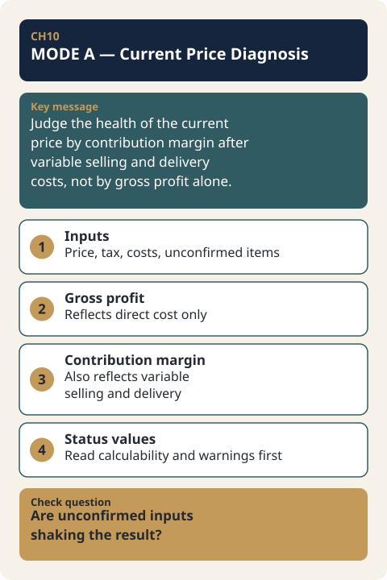

# CH10. MODE A — Current Price Diagnosis

> **Presentation key message:** The health of the current price must be judged by contribution margin after variable selling and delivery costs, not by gross profit alone.

## 1. Learning Objectives

Calculate the Gross Profit and Contribution Margin actually left on the current price, and interpret the results.

## 2. Core Concepts

Any discussion of price should start not with a bold strategy but with one fact that must be confirmed first: at the price and cost structure we are selling at right now, how much does a single unit transaction actually leave behind? Pricing Harness's MODE A (Current Price Diagnosis) is the module that answers exactly this question, and only this question. Every other strategic judgment — setting a target price, break-even analysis, competitive response — sits on top of this fact, and if this fact is wrong, everything built on it is wrong along with it.

Why this question comes first is already established in the principle on cost. Cost is the first real-world constraint that must be confirmed before setting a price, and in the absence of a special strategic judgment, it acts as the price's floor (KM044). Cost, moreover, is not estimated by starting from accounting line items, but by first listing the activities actually performed — technology development, production, sales and distribution — and then calculating the cost required for each activity (KM044). The cost derived this way must then be read through structures such as fixed/variable cost, direct/indirect cost, cost of goods manufactured, and SG&A in order to become usable input for business-strategy decisions (KM045).

MODE A is the actual computational implementation of this principle for a single product/service unit (component). It produces two figures: Gross Profit, which is the selling price minus direct cost, and Contribution Margin, which further subtracts the variable selling/delivery cost from Gross Profit.

## 3. Why It Matters

As value-based pricing (KM046) states, customers do not pay to reimburse the costs a company incurred internally. What the customer is willing to pay marks one boundary of the price; cost marks the other (KM046). But without knowing where this other boundary — the cost-side boundary — actually sits, the pricing conversation itself cannot get started. To discuss "is this price right," you first need to know "how much is actually left at this price."

MODE A's METHOD.md explains why this module exists in these terms: before talking about strategy, discounts, or competitive response, price consulting needs one settled fact — what remains after subtracting the costs clearly attributable to a given transaction from the price actually being charged right now. MODE A deliberately answers only the smallest, least contestable question in the entire Harness. Because every other module — target price setting (MODE B), allowable cost calculation (MODE C), break-even point (BEP), and strategic judgment — is built on top of this, an error in MODE A is inherited by all of them.

## 4. Framework / Logic

The 7 metrics MODE A calculates, and their definitions, are as follows (SPEC.md).

```
Gross Profit             = actual_price_ex_vat − direct_cost_total
Gross Profit Rate        = Gross Profit / actual_price_ex_vat
Contribution Margin      = Gross Profit − variable_cost_total
Contribution Margin Rate = Contribution Margin / actual_price_ex_vat
```

There is a terminology boundary that must be pointed out here. The 4 formulas above (the exact calculations for Gross Profit, Gross Profit Rate, Contribution Margin, and Contribution Margin Rate) and the rule that excludes `fixed_operating_cost` from Contribution Margin are **not concepts confirmed by the Master Note — they are Pricing Harness's own Internal Specification**. METHOD.md explicitly labels this as "Category B — Pricing Harness Internal Specification," and states that the underlying reference document (MASTER_NOTE_PRICING_REFERENCE §5.4) leaves "to what level margin concepts should be distinguished" as a still-open MN06 follow-up question.

What KM044, KM045, and KM046 support, by contrast, is a higher-level concept: that cost must be known before price can be set, that the activities of selling and delivery themselves carry costs, that channel-type costs (fees, etc.) change the price structure itself, and that what the customer pays for is value, not cost. That MODE A "answers this question" is itself a problem framing that the Master Note supports (METHOD.md's Category A), but the formula for "calculating it exactly this way" is an internal specification the Harness designed on its own. Not lumping these two together under the same word "margin" is the terminology boundary of this chapter.

Gross Profit and Contribution Margin also answer different questions. Gross Profit is the value obtained by subtracting only the direct cost of producing and delivering the product/service (`product_service_direct_cost`). Contribution Margin goes one step further, also subtracting the variable selling/delivery costs (`variable_selling_delivery`) — channel fees, PG fees, shipping, visit-service costs, and the like. Gross Profit can look healthy while Contribution Margin is thin or negative. It is Contribution Margin, not Gross Profit, that tells you whether selling this product through this particular channel was actually a profitable business. `fixed_operating_cost` (fixed SG&A such as rent and payroll) is included in neither Gross Profit nor Contribution Margin, because this cost is not the cost of any one transaction but the cost of sustaining the business — it is left for the future BEP (break-even point) module to handle.

## 5. Application Process

MODE A performs its calculation independently for each component in `product.price_components[]`. It never blends multiple components into a single combined value (SPEC.md, "MODE A never blends components"). For a single component, the inputs consumed are as follows.

1. `actual_price`, `currency`, `price_includes_vat` — the actual selling price, currency, and whether VAT is included
2. `tax.vat_rate` — the VAT rate
3. `fx.base_currency`, `fx.reporting_currency`, `fx.rate_base_per_reporting` — currency conversion information
4. Every `costs.items[]` entry attributable to this component — either directly, or with `applies_to_component = "shared"` and a resolvable `allocation_rule`

The calculation proceeds in the following order.

- First, use `actual_price` and the VAT information to derive net sales excluding VAT (`actual_price_ex_vat`). If `price_includes_vat = true`, divide by the VAT rate; if `false`, `actual_price` itself is the net sales value as-is (SPEC.md VAT rule).
- Sum the cost items attributable to this component that fall under the `product_service_direct_cost` category to obtain total direct cost (`direct_cost_total`).
- Subtract total direct cost from net sales to obtain Gross Profit, and divide by net sales to obtain Gross Profit Rate.
- Sum the costs under the `variable_selling_delivery` category to obtain total variable cost (`variable_cost_total`). For rate-based cost items, the `basis` field specifies whether the base is `rate_of_net_sales` (net sales excluding VAT) or `rate_of_gross_payment` (the actual amount paid, including VAT).
- Subtract total variable cost from Gross Profit to obtain Contribution Margin, and divide by net sales to obtain Contribution Margin Rate.

Each metric is produced in `{value, status, unit}` form, with status managed as one of three states: OK / UNKNOWN / ERROR. If even one of the inputs a metric depends on is an unconfirmed `null`, that metric becomes `UNKNOWN` — it is never arbitrarily replaced with `0`. If the configuration itself is semantically contradictory — for example, a `shared` cost item with `allocation_rule = direct` — it is treated as `ERROR` (SPEC.md "Shared cost items and allocation_rule"). The module's overall status is aggregated as `ERROR` if even one metric is `ERROR`; otherwise `INCOMPLETE` if even one metric is `UNKNOWN`; and `OK` only if all metrics are `OK`.

## 6. Applying This in Pricing or the Harness

Before running MODE A, a consultant must confirm what this module does *not* do. SPEC.md explicitly defines what is out of scope. The blended, whole-contract view that combines multiple components into one is not yet implemented (`NOT_IMPLEMENTED`); target price (MODE B), allowable cost (MODE C), and break-even point (BEP) remain separate modules. External competitor research, AI-generated pricing-strategy recommendations, report/quotation generation, and web dashboards are also not within MODE A's scope. MODE A calculates only one fact: how much a single unit actually leaves behind at the current price.

The terminology boundary established in Section 4 applies directly in practice as well. When a consultant presents Gross Profit / Contribution Margin figures to a client, they must not describe these formulas as "confirmed by Master Note theory." These formulas are Pricing Harness's internal specification. What the Master Note (and KM044, KM045, KM046) supports goes only as far as the problem framing that "cost must be known before price can be discussed" and the higher-level principle that "what the customer pays for is value, not cost." Without making this distinction clear, a consulting deliverable risks presenting a calculation rule the Harness itself designed as if it were validated theory.

It is also common in practice for Contribution Margin to remain unconfirmed while Gross Profit is confirmed. If variable selling costs (such as the PG fee rate) have not yet been settled, Gross Profit is produced as `OK` while Contribution Margin remains `UNKNOWN`. This is not a system error — it is MODE A's design principle of calculating only as far as the confirmed data supports, and never estimating beyond that.

## 7. Practical Checkpoints

- Has it been confirmed first whether this component's selling price includes VAT (`price_includes_vat`)? If this value is wrong, every metric downstream is off by the VAT rate.
- Were direct cost (`product_service_direct_cost`) and variable selling/delivery cost (`variable_selling_delivery`) entered as clearly distinct categories? Mixing the two collapses the meaning of both Gross Profit and Contribution Margin.
- Has the `basis` for rate-based cost items (such as PG fees) been confirmed — is it net sales excluding VAT, or the actual amount paid including VAT? The actual amount paid is always "net sales × (1 + VAT rate)," regardless of whether the displayed price includes VAT (SPEC.md).
- Has `allocation_rule = direct` been mistakenly set on a shared cost item classified as `shared`? This combination is semantically contradictory and the calculation is refused (`ERROR`).
- If a metric comes back `UNKNOWN`, has the dependency path in the warning message been checked to see which input is missing — rather than arbitrarily filling the value in with 0 or an estimate?
- When explaining the results to a client, was it made clear that the formulas for Gross Profit/Contribution Margin are the Harness's internal specification, and that this is a separate matter from the higher-level principle that "cost must be known before price can be set"?

## 8. Key Takeaways

MODE A is the module that calculates, at the component level, how much a single unit transaction actually leaves behind at the current price and cost structure. Gross Profit is the value after subtracting only direct cost; Contribution Margin further subtracts variable selling/delivery cost — the two answer different questions. The exact formulas are Pricing Harness's internal specification, while what the Master Note supports is the problem framing that "cost must be known first before price can be discussed" and the customer-value-centered pricing principle. When an input is not confirmed, the corresponding metric remains `UNKNOWN` and is never replaced with 0.



## 9. Practical Questions

- Is the selling price of what we currently sell quoted with VAT included, or not?
- What can be confirmed as the direct cost and the variable selling/delivery cost of this transaction, respectively? Which items remain unconfirmed?
- If Gross Profit looks healthy but Contribution Margin does not, which selling/delivery cost is creating that gap?
- For a product made up of multiple components (e.g., hardware + a subscription service), is there any part where Contribution Margin remains `UNKNOWN` because the allocation method for shared costs has not yet been defined?

## 10. Deep Dive: Standard Lecture Plan Enrichment

### 10.1 Read the status next to the number

MODE A's metrics come with a status, not just a value. Filling an unconfirmed value with 0 produces a margin with no basis (CH10-EX02), so the calculator computes only as much as the confirmed data supports. The status names in the Harness specification quoted by the handbook are as follows.

| Status | Meaning | Where it appears |
|---|---|---|
| OK | Computed because every input it depends on is confirmed | Metrics in all modules |
| UNKNOWN | Some input is unconfirmed, so it cannot be answered right now | Metrics in all modules |
| ERROR | The setup is contradictory or cannot hold under these conditions | All modules |
| INCOMPLETE | Module-level status when a metric is UNKNOWN and none is ERROR | Module aggregate |
| NOT_APPLICABLE | All inputs are known, but the concept does not hold under this price/cost structure | Break-even (CH13), scenario delta (CH14) |
| NOT_RUN | That question has not been asked yet (not an error) | Sales-volume P&L (CH13) |
| NOT_IMPLEMENTED | The concept exists but the calculator does not do it yet | Combined whole-contract view of components (CH10 §6) |

The typical case is Gross Profit being OK while Contribution Margin is UNKNOWN. If the fee rate is not yet confirmed, leaving Contribution Margin blank is the accurate answer; do not insert an arbitrary number or 0.

### 10.2 The fee basis changes Contribution Margin

[Practice-only hypothetical data] A handmade rice-cookie set of 6 is sold at 15,000 KRW including VAT. Direct cost is 6,000 KRW, parcel delivery is 3,000 KRW, and the channel fee is 5%. Net sales are 15,000 ÷ 1.10 = 13,636.36 KRW.

| Item | Fee on gross payment | Fee on net sales |
|---|---|---|
| Fee | 15,000 × 5% = 750 KRW | 13,636.36 × 5% = 681.82 KRW |
| Total variable cost | 3,750 KRW | 3,681.82 KRW |
| Gross Profit | 7,636.36 KRW (56.0%) | 7,636.36 KRW (56.0%) |
| Contribution Margin | 3,886.36 KRW (28.5%) | 3,954.55 KRW (29.0%) |

Whichever basis is used, Gross Profit is the same and only Contribution Margin differs, by about 68 KRW. The gross payment is net sales × (1 + VAT rate), regardless of whether the displayed price includes VAT. Even for the same 5%, confirm which amount the channel contract uses as the basis before entering it. The fee rate and basis in this case are assumptions. A Gross Profit margin of 56% looks generous while the Contribution Margin rate is 28.5%, which ties into this chapter's core message. To practice the same sequence with a 33,000 KRW product, see [CH10-EX03](../examples/CH10-EX03-mode-a-33000-fee-basis.md).

### 10.3 The unit of calculation is the price component

A product with several components, such as hardware and a subscription, is entered component by component and calculated separately. [Practice-only hypothetical data] For sensor hardware (220,000 KRW, direct cost 110,000 KRW, delivery 8,000 KRW), Contribution Margin is 82,000 KRW (41.0%); for the subscription (22,000 KRW per month, direct cost 3,000 KRW, fee 3%), it is 16,340 KRW (81.7%). Averaging the two helps neither price decision, and the combined view is NOT_IMPLEMENTED. The calculation steps are in [CH10-EX04](../examples/CH10-EX04-hybrid-components-separately.md).

With two or more components, limits carry over into later modules. Shared costs enter the calculation only when the allocation rule is supported (CH12 §6), break-even performs no calculation at all (CH13 §4), and only one target Contribution Margin rate can be set for the whole (CH11 §6). A product with a single component does not need to worry about these limits.

### 10.4 Currency and exchange-rate inputs

The selling price has a currency (`currency`), and the conversion information has three fields: base currency, reporting currency, and exchange rate (`fx.rate_base_per_reporting`). The handbook gives only the names of these fields and does not provide the conversion direction or a worked example. When selling in a foreign currency, confirm the conversion direction first and then enter the values.

### Points that need confirmation

- The conversion direction and unit of `rate_base_per_reporting` are not defined in the handbook, so they are not asserted here.
- The handbook does not define how to allocate shared costs to components or how to combine component-level results.
- It has not been confirmed whether the status names above appear under the same names on the site calculator screen.

## Source Map

- MN: MN06 (concept)
- KM: KM044, KM045, KM046
- Harness: core/engine/modes/mode_a.py (run_mode_a), docs/features/mode_a_current_price/{SPEC,METHOD,CASE}.md
- SL: 3-1-02 (MODE A rice cookie), 3-1-09 (Problem 1), 3-1-14 (status values, components, exchange rate)
