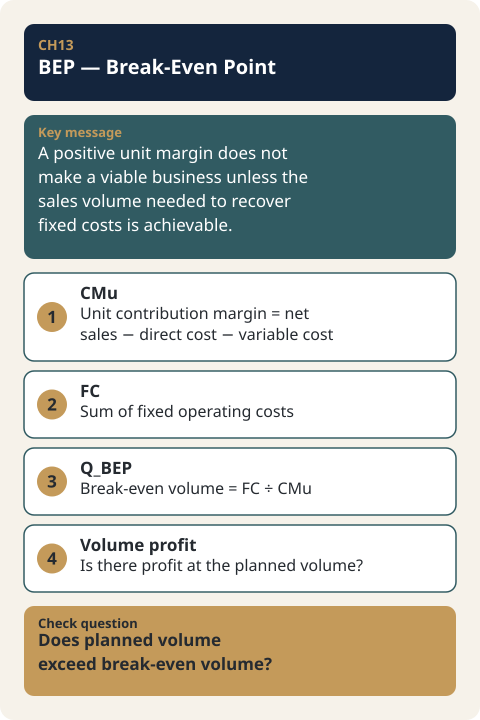

# CH13. BEP — Break-Even Point

> **Presentation key message:** A positive unit margin does not make a viable business unless the sales volume required to recover fixed costs is achievable.

## 1. Learning Objectives

Be able to calculate the sales quantity required to recover fixed costs, given the current price and Contribution Margin structure.

## 2. Core Concepts

BEP (Break-Even Point) answers the question: "Given the current price and Contribution Margin structure, how many units must be sold to recover fixed operating costs?" No matter how positive the per-unit contribution margin (CMu, Contribution Margin per unit) may be, if the fixed operating cost (FC, fixed operating cost) is large enough relative to it, the business as a whole can still run at a loss. In other words, a price that "leaves something" on a per-unit basis is not yet a viable business if that margin cannot fully recover the fixed costs. BEP calculates exactly this point — the sales quantity at which fixed costs are precisely recovered.

The formula is simple.

```
CMu = N − direct_cost − variable_cost_total   (same Contribution Margin definition as MODE A)
FC  = total fixed operating cost for the component/analysis period in question
Q_BEP = FC / CMu
```

Here, N is the current actual selling price (actual price) on a VAT-exclusive basis. Like MODE A among MODE A/B/C, BEP deals only with "the price as it stands right now" — substituting a target price (MODE B) or a market price (MODE C) into the calculation instead is outside the scope of BEP v0.1, and is designed to be handled by a future, separate Scenario Compare module.

## 3. Why It Matters

A common mistake when setting pricing strategy is oversimplifying to "if the per-unit margin is positive, the more you sell, the more you gain." But as long as fixed costs exist, actually turning a profit requires selling above a certain quantity. BEP makes this "certain quantity" concrete, moving business feasibility from a qualitative judgment to a quantitative one. It is also a tool for verifying, in concrete sales-quantity terms, the core question on the Cost axis of the QCD (Quality·Cost·Delivery) review that KM060 describes — "can this be made at an affordable cost?" If the cost calculation shows a structure where selling more only loses more money, then even if quality and delivery conditions are met, the business does not hold up — and BEP turns KM060's principle into the practical number of "how many units must be sold before this stops being a loss."

## 4. Framework / Logic

BEP requires only two inputs — the Contribution Margin structure of the current price (independently recalculated the same way as MODE A), and fixed operating cost. `docs/features/bep/SPEC.md` lays this out as follows.

- **CMu (Contribution Margin per unit)**: Follows MODE A's Contribution Margin definition exactly — `N − direct_cost − variable_cost_total`. Rather than simply reading MODE A's already-computed result, BEP recalculates this independently from `client_input` using the same logic (`price_converted`, `sum_cost_category` in `core/engine/economics.py`). This design exists so that when a future Scenario Compare feature is added that calculates BEP against a target price or market price, it can be extended without depending on MODE A's result object.
- **FC (fixed operating cost)**: The sum of items where `cost_category = "fixed_operating_cost"`. This is a cost category that MODE A/B/C never read at all, so it is the first time BEP addresses this cost category.
- **Handling results based on the sign of CMu**: If CMu > 0, `Q_BEP = FC / CMu` is calculated normally (OK). If CMu = 0 or CMu < 0, break-even cannot be reached at any sales quantity (margin = 0), or the loss only grows the more you sell (margin < 0) — so `break_even_quantity_exact` is displayed as having no value (`NOT_APPLICABLE`), together with a warning explaining why. This value means neither "cannot be calculated (UNKNOWN)" nor "error (ERROR)" — all inputs are known, but the concept of "break-even sales quantity" itself does not hold for this price/cost structure.
- **When fixed cost is zero or absent entirely**: If there are no fixed cost items at all, or one is explicitly entered as zero, FC = 0 is confirmed (OK), and if CMu > 0, Q_BEP = 0. This is a normal, meaningful result — "with no fixed cost, break-even is reached from the very first unit."
- **Multi-component restriction**: If a product consists of two or more price components (price_components), BEP v0.1 does not perform the calculation at all and returns `ERROR` (code: `MULTI_COMPONENT_BEP_NOT_SUPPORTED`). This is a structural restriction to prevent shared fixed costs from being double-counted or misallocated across components.
- **`blended_only` handling of shared fixed cost**: For shared cost items with `allocation_rule = "blended_only"`, MODE A/B/C exclude this cost from the calculation (treating it as 0), but because fixed cost is itself the numerator in BEP, BEP treats it as `UNKNOWN` (treating it as 0 would silently drop a fixed cost that actually exists). Per the check in SPEC.md section 4, all four of the example Client Inputs that currently exist enter their fixed costs as `shared` + `blended_only`, so in practice this UNKNOWN case may actually appear quite often.

## 5. Application Process

1. Confirm whether the target product's price components are a single component. If there are two or more, it cannot be calculated with BEP v0.1.
2. Convert the current actual selling price (actual price) to N (net_sales_ex_vat, net sales excluding VAT) based on its VAT treatment.
3. Sum the direct cost (product_service_direct_cost) and variable cost (variable_selling_delivery) for the component in question to calculate CMu.
4. Sum all fixed operating cost (fixed_operating_cost) items attributable to the component in question to obtain FC. At this point, confirm that the items' `basis` (analysis period, e.g. `per_month`) all match — if they don't match, the calculation cannot be performed.
5. Check the sign of CMu. If it is greater than 0, calculate `Q_BEP = FC / CMu`. If it is 0 or less, conclude that break-even sales quantity is undefined, and record the reason together with that conclusion.
6. Note that the "sales quantity" represented by the resulting Q_BEP is a quantity within the analysis period indicated by FC's `basis` (e.g. one month).

## 6. Applying This in Pricing or the Harness

Pricing Harness implements BEP as the `run_bep(client_input)` function in `core/engine/modes/bep.py`, using the same uniform signature as the other modes (MODE A/B/C), taking only `client_input` as input. Internally, it shares the primitives (`price_converted`, `sum_cost_category`) in `core/engine/economics.py` with MODE A, and also calls the fixed-operating-cost aggregation (`sum_fixed_operating_cost`) from the same file (the Volume Profit module described below uses that aggregation too), but does not reference `mode_a.py` directly — this design ensures BEP is not tied to a specific mode's result object when a future Scenario Compare feature that substitutes a target price or market price is built. `docs/features/bep/SPEC.md` and `docs/features/bep/CASE.md` define this calculation logic and 23 test cases (TC1–TC23) in detail, and `tests/test_bep.py` (541 lines) implements the actual automated tests. When using this tool in practice, one should understand beforehand that the reliability of the BEP result increases the more accurate the current selling price's Contribution Margin structure (the MODE A result) and the fixed operating cost inputs are, and that the calculation itself is restricted within v0.1's scope for multi-component products or when shared fixed cost is entered only as `blended_only`.

**The question after BEP — profit at a planned quantity (Volume Profit).** BEP produces sales quantity only as an output (Q_BEP), never as an input. It therefore cannot answer "how much is left if we sell 500 a month?" or "is our current volume safe relative to break-even?" Pricing Harness handles these questions in a separate module, Volume Profit (`run_volume_profit(client_input)` in `core/engine/modes/volume_profit.py`, specified in `docs/features/volume_profit/SPEC.md`). It is the only capability in the Harness that takes a quantity as input. When a planned sales quantity Q is entered in the Client Input's `sales_plan` (`planned_quantity`, `period_basis`), it calculates the operating profit for the period at the current selling price if Q units are sold, and how far that plan sits above or below the break-even quantity (the margin of safety).

```
operating_profit          = CMu × Q − FC
margin_of_safety_quantity = Q − Q_BEP
margin_of_safety_rate     = (Q − Q_BEP) / Q
```

CMu, FC, and Q_BEP use exactly the same definitions as BEP in this chapter, and fixed cost is likewise never spread per unit. The scope and handling rules to know in practice are as follows.

- If `sales_plan` is absent entirely, the module is not an error but `NOT_RUN` (it means the question has not been asked yet). If `sales_plan` is present but `planned_quantity` is `null`, the result is `UNKNOWN`. `planned_quantity = 0` is a valid plan of "no sales", and operating profit is then −FC.
- The period of the planned quantity currently supports `per_month` only. The `basis` of the fixed operating cost items must also be `per_month`; any other `basis` produces `ERROR` (`UNSUPPORTED_FIXED_COST_BASIS_FOR_VOLUME`).
- As with BEP, only a single price component is supported. Two or more produce `ERROR` (`MULTI_COMPONENT_VOLUME_PROFIT_NOT_SUPPORTED`).
- If the planned quantity falls short of Q_BEP, the margin of safety is shown as a negative number. It is not clamped to 0; the status stays `OK` and a `BELOW_BREAK_EVEN` warning is attached. This contrasts with BEP, which gives no value when CMu ≤ 0.
- If any direct-cost or variable-cost item has `basis = "per_order"`, the calculation assumes one unit is sold per order. Metrics that depend on `CMu × Q` then carry the `ESTIMATED` status and an `ASSUMES_ONE_UNIT_PER_ORDER` warning. If customers buy more than one unit per order, cost is overstated and operating profit is understated.
- The module does not forecast demand. `planned_quantity` is simply an input supplied from outside, and how quantity responds when price changes is not modeled.
- It is not yet part of Scenario Compare (CH14).

As with BEP, the operating-profit and margin-of-safety formulas and status rules in Volume Profit are not concepts defined by the Master Note; they are the Pricing Harness's Internal Specification. What the Master Note supports is only the framing that business feasibility must be judged "at a specific price and a specific quantity."

## 7. Practical Checkpoints

- Are you about to launch a product with CMu at or below zero? Even before calculating BEP, if the per-unit margin itself is negative or zero, no amount of increased sales volume will reach break-even.
- Are you inadvertently summing fixed operating cost items whose `basis` (monthly / per transaction / per visit, etc.) differ from one another? If the basis differs, summing is simply not possible.
- If the product has a multi-component structure, are you aware that the BEP v0.1 calculation covered by this chapter is not yet supported for it?
- If there is a shared fixed cost, have you confirmed what its allocation rule (`allocation_rule`) is? If it is `blended_only`, BEP is unable to reflect that cost in the calculation and leaves it as UNKNOWN.
- The resulting Q_BEP is an exact, unrounded figure (e.g. 104.68 units) — whether to round up when practically expressing "how many units must be sold" is a decision to be made separately at the report/dashboard stage that consumes this figure (the engine itself has no rounding policy).
- If you want to check profit at a planned quantity (Volume Profit), have you confirmed that the quantity is monthly and that the fixed operating cost `basis` is also monthly (`per_month`)? If there are `per_order` costs, also check that the "one unit per order" assumption matches actual purchase patterns.
- As KM062 explains, the meaning of sales quantity (Qty) is derived from entirely different grounds depending on B2C, B2B, or B2G. The Q_BEP that BEP calculates is merely an arithmetic target quantity — "how many units must be sold to break even" — and whether this number is actually achievable must be verified separately against the basis for determining Qty by transaction type (e.g. target customer count × purchase frequency for B2C, order size for B2B, budget/legal obligations for B2G).

## 8. Key Takeaways

BEP is a tool that takes only the current price's Contribution Margin structure and fixed operating cost as inputs, and calculates the sales quantity required to reach break-even (Q_BEP = FC / CMu). The fact that the per-unit margin is positive alone cannot determine viability — only by confirming the specific sales quantity needed for that margin to recover fixed costs can feasibility actually be checked quantitatively. BEP v0.1 supports only single-price-component products, and reveals situations where the calculation does not hold or is uncertain — such as CMu at or below zero, or shared fixed cost that has not been fully allocated — not as a value but as a clear status code (NOT_APPLICABLE/UNKNOWN/ERROR) together with a warning message.



## 9. Practical Questions

- What is CMu at the current selling price, and does its sign correspond to a structure in which break-even sales quantity can be defined?
- What items make up the fixed operating cost attributable to this product, and do their analysis periods (basis) match?
- Is the sales quantity produced as Q_BEP actually achievable for this product's transaction type (B2C/B2B/B2G)?
- If this product has a multi-component structure or shared fixed cost, where does that restrict or introduce uncertainty into the BEP calculation itself?

## 10. Deep Dive: Standard Lecture Plan Enrichment

### How Break-Even and Volume Profit Move When the Price Changes

Knowing only CMu and FC, you can compare the BEP for each price and the operating profit at the planned sales quantity in a single table. Assume a handmade rice cookie 6-piece set (VAT-inclusive price, direct cost 6,000 KRW, delivery 3,000 KRW, fee at 5% of the amount actually paid, monthly fixed operating cost 600,000 KRW, planned 250 sets per month). [Practice-only hypothetical data]

| Selling price | Net sales (N) | Variable cost | CMu | Q_BEP | Operating profit at 250 sets | Margin of safety (quantity) |
|---|---|---|---|---|---|---|
| 12,000 KRW | 10,909.09 | 3,600 | 1,309.09 | 458.3 | −272,727 | −208.3 |
| 15,000 KRW | 13,636.36 | 3,750 | 3,886.36 | 154.4 | 371,591 | 95.6 (38.2%) |
| 18,000 KRW | 16,363.64 | 3,900 | 6,463.64 | 92.8 | 1,015,909 | 157.2 |

Cutting the price by 20% shrinks CMu to about one third (3,886 → 1,309) and raises the break-even quantity to about three times (154.4 → 458.3). The fixed cost is unchanged, but the margin per unit gets thinner. At 12,000 KRW the planned sales quantity falls short of break-even, so the margin of safety is negative and a `BELOW_BREAK_EVEN` warning is attached. Conversely, at 18,000 KRW selling only 150 sets a month gives an operating profit of 369,545 KRW, similar to 15,000 KRW at 250 sets (371,591 KRW). However, how the quantity changes when the price changes is an assumption, not a calculation, and Volume Profit does not model it (§6).

### Five Situations for Reading Break-Even

| Situation | Result | How to read it |
|---|---|---|
| CMu > 0, FC confirmed | `Q_BEP = FC / CMu`, `OK` | The sales quantity over the analysis period (e.g., a month) |
| CMu ≤ 0 | `NOT_APPLICABLE` + warning | All inputs are known, but the break-even concept does not hold. Change the price, cost, and fee structure before the quantity |
| Fixed cost item absent or entered as 0 | FC = 0 confirmed; if CMu > 0, `Q_BEP = 0` | Break-even from the first unit |
| Fixed cost item present but amount blank | `UNKNOWN` | It cannot be answered now. Do not delete the item; leave it as unknown and write down how to confirm it |
| Fixed cost items have different `basis` / two or more price components | Not calculated / `ERROR` | Unify the period to monthly. With two or more components you can enter them one at a time and read each separately, but the handbook has no method for summing those results |

An example of CMu ≤ 0. At a selling price of 9,000 KRW (VAT-inclusive), direct cost 6,000 KRW, delivery 3,000 KRW, and a 5% fee (450 KRW), N = 8,181.82 and CMu = 8,181.82 − 6,000 − 3,450 = −1,268.18 KRW. This is a state with no value, and it is neither `UNKNOWN` nor `ERROR`. [Practice-only hypothetical data] Telling "the item is absent" (a confirmed 0) apart from "the item is present but its value is blank" (`UNKNOWN`) is the same as telling apart a cell deleted from a table and a cell left empty.

### Shortfall Against Planned Sales Quantity and the Effect of Per-Order Cost

If the rice cookie above (15,000 KRW) sells only 100 sets a month, operating profit is 3,886.36 × 100 − 600,000 = −211,364 KRW and the margin of safety is 100 − 154.4 = −54.4 sets. The value is shown as negative as it is, the status stays `OK`, and only a warning is attached (§6). If the 3,000 KRW delivery fee is `per_order`, one unit sold per order is assumed, so the metrics become `ESTIMATED`. In the extreme case where every order is 2 sets, the delivery cost per set is 1,500 KRW, CMu becomes 5,386.36 KRW, and the operating profit at 250 sets changes from 371,591 KRW to 746,591 KRW. That every order is 2 sets is an extreme assumption made for illustration. [Practice-only hypothetical data] As §6 states, if the quantity purchased per order is greater than 1, cost is overstated and operating profit is understated. For practice, see [CH13-EX03](../examples/CH13-EX03-volume-profit-practice-problem.md).

### Monthly Break-Even by Transaction Type — A Manufacturing Case

Take as the source values a year-1 pet cat tower company's second-round funding price of 545,000 KRW, manufacturing cost per unit of 389,000 KRW, and monthly fixed costs of 8,000,000 KRW (based on mass production of 60 units a month). The monthly break-even for each price option is as follows. Contribution margin here is the value after subtracting manufacturing cost only (the problem has no fee or delivery information).

| Price option | Contribution margin per unit | Monthly break-even | Margin of safety rate vs. 60 units a month | Operating profit at 60 units a month |
|---|---|---|---|---|
| 545,000 KRW (second-round funding price) | 156,000 | 51.3 units | 14.5% | 1,360,000 |
| 572,250 KRW (+5%) | 183,250 | 43.7 units | 27.2% | 2,995,000 |
| 626,750 KRW (+15%) | 237,750 | 33.7 units | 43.9% | 6,265,000 |
| 654,000 KRW (+20%) | 265,000 | 30.2 units | 49.7% | 7,900,000 |

At 545,000 KRW the margin of safety for the 60-units-a-month plan is only about 15%. In the 200-unit mass production option (manufacturing cost per unit 311,200 KRW, monthly operating profit 35,760,000 KRW), back-calculating the fixed costs as 11,000,000 KRW gives a break-even of 47.0 units and a margin of safety rate of 76.5%. Fixed cost rises 37.5%, but contribution margin per unit rises 49.9% and the quantity grows, so operating profit becomes about 26 times larger. But break-even is only "how many units must be sold"; the basis for 200 units actually selling must be verified separately as the Qty estimation basis by transaction type (§7).

### Calculating Backwards from the Target Sales Quantity

Starting from "how much must I earn at minimum in a month," the same structure is used in reverse. Target revenue is the sum of fixed costs (the share needed for living and the share needed for the business), variable costs, and the desired net profit. Variable costs are proportional to sales quantity, so the actual calculation uses the profit per unit (selling price − variable cost per unit).

```
Monthly minimum sales quantity        = monthly fixed cost / profit per unit            (= FC / CMu)
Sales quantity including net profit   = (monthly fixed cost + desired net profit) / profit per unit
With several products                 = monthly fixed cost / (profit per unit, weighted-averaged by sales mix)
```

With a monthly fixed cost of 5,900,000 KRW and a profit per unit of 3,000 KRW, the result is 1,966.7 cups (1,967 cups rounded up), and adding a desired net profit of 500,000 KRW gives about 2,133.3 cups. Using an average profit per unit with an assumed sales mix is not a calculation defined by the handbook but a manual application of the same formula. This quantity is the minimum target needed to survive, and its achievability is verified separately. For practice, see [CH13-EX04](../examples/CH13-EX04-cafe-minimum-sales-target.md).

### Points that need confirmation

- The source does not say whether the selling prices in the hypothetical cafe example include or exclude VAT. If they are VAT-inclusive, VAT must be subtracted first.
- The fixed cost of 11,000,000 KRW and the "monthly mass-production quantity" basis for the 200-unit cat tower option are values back-calculated from the source's operating profit. Other costs of the company, such as fees and delivery, are not in the problem and are not reflected.
- The handbook does not explain how break-even is handled when shared fixed costs are entered with an allocation rule other than `blended_only` (`direct`, `by_component_revenue`, `fixed_share`).

## Source Map

- MN: MN07 (concept)
- KM: KM060, KM062
- Harness: core/engine/modes/bep.py (run_bep), docs/features/bep/{SPEC,METHOD,CASE}.md; core/engine/modes/volume_profit.py (run_volume_profit), docs/features/volume_profit/SPEC.md
- SL: 3-1-14 (Reading the calculator D4–D5), 3-1-09 (Integrated case practice Case 1, Problem 4), 3-1-10 (AI workshop section E, target sales quantity), 3-1-02 (Break-even section D), 3-1-12 (Condensed version section D)
