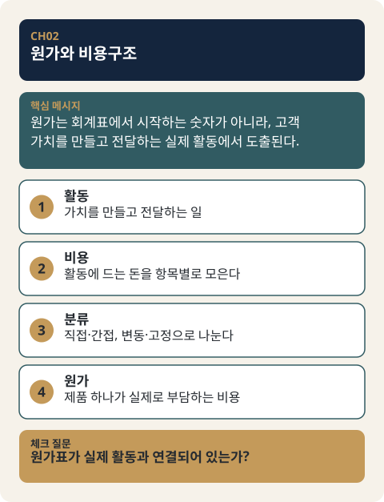

# CH02. 원가와 비용구조

> **발표 핵심 메시지:** 원가는 회계표에서 시작하는 숫자가 아니라, 고객가치를 만들고 전달하는 실제 활동에서 도출되는 가격의 현실적 하한선이다.

## 1. 학습목표

활동에서 비용이 발생하는 논리와 고정비·변동비·직접비·간접비 구분을 적용할 수 있다.

## 2. 핵심개념

원가는 가격을 정하기 위해 가장 먼저 확인해야 하는 현실의 제약조건이다. 전략적으로 가격을 결정하는 경우에도, 원가는 여전히 가격의 현실적 하한선 역할을 하는 제약조건으로 남는다. 즉 아무리 정교한 가격전략을 세우더라도, 그 가격이 원가를 지속적으로 밑돈다면 사업은 버틸 수 없다.

비용을 파악하는 출발점은 회계계정이 아니라 실제 활동이다. 기술개발, 제품생산, 판매유통, 인력 운용과 같이 사업이 실제로 수행해야 할 활동을 먼저 나열하고, 그 각각의 활동에 어떤 비용이 필요한지를 계산하는 방식으로 접근한다. 이렇게 도출된 비용은 다시 몇 가지 기준으로 분류해서 읽을 수 있다. 생산량과 무관하게 일정하게 발생하는지(고정비) 아니면 생산·판매량에 따라 변하는지(변동비), 그리고 특정 제품이나 서비스에 직접 추적할 수 있는지(직접비) 아니면 여러 부서·제품에 걸쳐 있어 귀속이 어려운지(간접비)가 그 기준이다. 제조기업은 재료비·노무비·제조경비를 합산해 제조원가를 계산하고, 유통기업은 상품 매입원가를 기준으로 삼으며, 여기에 판매관리비를 더하면 총원가에 가까워진다.

## 3. 왜 중요한가

비용구조를 어떻게 설계하느냐가 사업전략 자체를 바꾼다. 고정비가 큰 사업은 일정 수준의 판매량을 확보하지 못하면 버티기 어렵고, 변동비가 높은 사업은 판매량이 늘어도 단위당 이익이 충분히 남는지를 계속 확인해야 한다. 제조원가가 높은 상품은 유통단계를 줄이거나 생산량을 늘려 단위당 원가를 낮추는 방안을 검토하게 된다. 이처럼 원가 분석은 단순한 회계작업이 아니라, 고객·채널·생산방식·판매량을 다시 보게 만드는 전략적 필터다.

## 4. Framework / Logic

이 장에서 다루는 논리는 두 단계로 이어진다.

첫째, 활동에서 비용을 추정하는 단계다. 사업이 수행해야 할 활동을 먼저 나열한다. 기술개발을 하려면 연구인력, 견본, 재료, 기술도입, 위탁개발, 장비, 정보활용 등의 비용이 발생한다. 제품을 생산하려면 재료, 생산인력, 임차, 외주가공, 운반·보관·포장비 등이 필요하다. 판매유통에는 시장조사, 유통망 확보, 광고, 전시회, 견본, 판매인력이 필요하다. 사업계획의 실행내용이 구체적일수록 비용추정도 구체화된다.

둘째, 이렇게 도출된 비용을 구조로 읽는 단계다. 회계학은 원가와 비용을 엄밀하게 구분하지만, 사업기획자에게 필요한 것은 그런 엄밀한 구분보다 "상품을 만들고 유통하고 판매하는 데 들어가는 총비용"을 파악하는 실무적 관점이다. 그 총비용을 고정비/변동비, 직접비/간접비라는 두 축으로 나누어 보면, 어떤 활동이 판매량과 무관하게 부담으로 남는지, 어떤 활동이 특정 제품에 귀속되는지가 드러난다.

## 5. 적용 절차

1. 사업이 실제로 수행할 활동을 기술개발·생산·판매유통·인력 등으로 나열한다.
2. 각 활동에 필요한 세부 비용 항목(인력, 재료, 장비, 외주, 유통, 광고 등)을 나열한다.
3. 나열된 비용 항목을 고정비/변동비로 구분한다.
4. 나열된 비용 항목을 직접비/간접비로 구분한다.
5. 제조기업은 재료비·노무비·제조경비를 합산해 제조원가를, 유통기업은 매입원가를 산출한다.
6. 판매관리비를 더해 총원가에 근접한 수치를 파악한다.
7. 이 활동과 비용을 감당한 뒤에도 이익을 남길 수 있는지 판단한다.

## 6. Pricing 또는 Harness 적용

이 장에서 정리한 비용구조(고정비·변동비·직접비·간접비, 제조원가·판매관리비)는 이후 책의 Part III에서 다루는 Pricing Harness의 MODE A 계산에 직접 투입되는 입력값이 된다. MODE A의 세부 계산 로직은 이 장에서 다루지 않으며, 여기서는 그 계산에 필요한 원가 항목을 정확히 구분해 두는 것이 이후 단계의 전제가 된다는 점만 짚어둔다.

## 7. 실무 체크포인트

- 비용을 회계계정에서 먼저 찾지 않고, 실제 활동에서 출발했는가.
- 사업계획의 실행내용이 구체적이어서 비용추정도 그만큼 구체적인가.
- 고정비 비중이 큰 구조인지, 변동비 비중이 큰 구조인지 파악했는가.
- 직접비와 간접비를 구분해 특정 제품·서비스에 귀속되는 비용을 명확히 했는가.
- 제조원가(또는 매입원가)에 판매관리비를 더해 총원가에 근접한 수치를 파악했는가.
- 이 비용구조가 가격 결정과 채널·생산방식·판매량 판단에 어떤 영향을 주는지 검토했는가.

## 8. 핵심정리

원가는 가격의 현실적 하한선이며, 비용은 회계계정이 아니라 실제 활동에서 도출한다. 활동에서 도출된 비용은 고정비/변동비, 직접비/간접비로 구분해 읽고, 제조원가(또는 매입원가)와 판매관리비를 더해 총원가를 파악한다. 비용구조 설계는 회계작업이 아니라 사업전략 자체를 바꾸는 전략적 필터다.

## 9. 실무 질문

- 우리 사업이 실제로 수행하는 활동은 무엇이며, 각 활동에는 어떤 비용이 필요한가?
- 우리 비용구조에서 고정비와 변동비의 비중은 어떠한가?
- 특정 제품·서비스에 직접 귀속되는 비용과 그렇지 않은 비용을 구분했는가?
- 판매량이 늘어날 때 단위당 이익이 실제로 확보되는 구조인가?
- 이 비용구조를 감당한 뒤에도 이익을 남길 수 있는가?

## 10. 심화: 표준강의안 보강

### 원가와 비용: 언제 생기고 어디에 기록되는가

원가는 자원을 얻는 과정에서, 비용은 자원을 쓰는 과정에서 생긴다. 제조원가는 팔리기 전까지 재고자산에 들어 있다가 팔린 뒤에 매출원가라는 비용이 된다. 유통업의 매출원가는 팔려서 고객에게 넘어간 상품의 구입금액이다. 판매와 관리 활동에 드는 판매관리비는 쓴 기간의 비용으로 바로 기록된다.

| 구분 | 언제 생기나 | 어디에 기록되나 |
|---|---|---|
| 제조업의 제조원가 | 제품을 만드는 과정 | 팔리기 전에는 재고자산, 팔린 뒤에는 매출원가 |
| 유통업의 매입원가 | 상품을 구입할 때 | 팔리기 전에는 재고, 팔린 뒤에는 매출원가 |
| 판매관리비 | 판매·관리 활동에 자원을 쓸 때 | 그 기간의 비용 |

그래서 제조원가는 재고가능원가, 판매관리비는 재고불가능원가(기간원가)다. 100개를 만들어 60개만 팔았다면 매출원가에는 60개분이 들어가고 남은 40개분의 제조원가는 아직 비용이 아니라 재고자산이다. 반대로 매장 점원의 월급은 팔았든 못 팔았든 그 달의 비용이다.

### 제조원가와 판매관리비 구분: 제과점 예

제조원가는 재료비·노무비·제조경비의 합이고, 판매관리비는 판매와 관리에 드는 비용(비제조원가라고도 한다)이다. 만드는 일과 파는 일이 어디서 나뉘는지는 제과점으로 보면 분명해진다.

| 구분 | 제조원가(만드는 활동) | 판매관리비(파는·관리하는 활동) |
|---|---|---|
| 재료 | 밀가루와 계란 등 재료 | — |
| 사람 | 월급 받는 제빵사 | 월급 받는 매장 점원 |
| 설비·경비 | 빵을 굽는 오븐 | 생활정보지 광고 |

업종별로는 제조업은 제조원가가 매출원가가 되고 판매 과정의 비용이 판매비, 사업 전체를 관리하는 활동의 비용이 관리비다. 유통업은 팔린 상품의 구입금액이 매출원가이고, 인건비·감가상각비·소모품비 같은 영업비용은 판매비와 관리비로 나뉜다.

### 직접비·간접비와 배부

직접비는 원가 대상(제품 등)별로 분리해 추적할 수 있는 비용이고, 간접비는 여러 제품이 함께 쓰기 때문에 그럴 수 없는 비용이다. 간접비는 전체 금액을 먼저 파악한 뒤 필요하면 원가 대상에 나누는데, 이를 배부라 한다. 추적 가능 여부는 기술적 가능성만이 아니라 추적의 경제성도 함께 본다. 제품별로 분리해 집계하는 수고에 비해 얻는 것이 적으면 공통비로 처리한다.

제조원가는 아래 여섯 칸으로 나누어 보면 직접비와 간접비가 드러난다. 제조간접비는 간접재료비, 간접노무비, 간접경비의 합이다.

| 칸 | 뜻 | 예 |
|---|---|---|
| 직접재료비 | 제품별로 쉽게 분리되는 주요 재료 | 철판, 타이어 |
| 간접재료비 | 제품별로 분리하기 어려운 재료 | 윤활유, 납땜 |
| 직접노무비 | 특정 제품 생산라인의 생산직 급여 | 특정 자동차 생산라인 생산직 |
| 간접노무비 | 여러 제품 생산을 지원하는 사람의 급여 | 구매·설계·자재관리 부서 직원, 감독자 |
| 직접경비 | 특정 제품 생산에만 생기는 경비(예외) | 외주가공비, 전용설비의 감가상각비·수선비 |
| 간접경비 | 제품별 분리가 어려운 경비(대부분) | 제조경비 중 직접경비를 뺀 나머지 |

간접비를 어떤 기준으로 나누느냐에 따라 제품별 원가는 달라진다. 기준은 회사가 정하며 정답이 하나로 정해져 있지 않다. 제조간접비 100만 원을 직접노무시간과 기계시간으로 나눈 가상 계산은 [CH02-EX01](../examples/CH02-EX01-overhead-allocation-basis.md)에 있다.

### 변동비와 고정비가 만드는 개당 원가와 이익

활동수준(생산·판매량)이 늘면 변동비는 함께 늘고 고정비는 그대로여서, 개당 총원가는 수량이 늘수록 내려간다. 아래는 개당 변동비 3,000원, 월 고정비 600,000원의 〔실습용 가상자료〕다.

| 수량 | 변동비 | 고정비 | 총원가 | 개당 총원가 |
|---|---|---|---|---|
| 100개 | 300,000원 | 600,000원 | 900,000원 | 9,000원 |
| 200개 | 600,000원 | 600,000원 | 1,200,000원 | 6,000원 |
| 300개 | 900,000원 | 600,000원 | 1,500,000원 | 5,000원 |
| 400개 | 1,200,000원 | 600,000원 | 1,800,000원 | 4,500원 |

비용구조가 다르면 같은 가격에서도 이익의 모양이 달라진다. 가격 6,000원에서 두 구조를 비교한 〔실습용 가상자료〕는 다음과 같다.

| 구조 | 비용 | 개당 공헌이익 | 손익분기 | 100개 판매 | 400개 판매 |
|---|---|---|---|---|---|
| A 고정비 큰 구조 | 고정 800,000원 + 변동 2,000원/개 | 4,000원 | 200개 | -400,000원 | 800,000원 |
| B 변동비 큰 구조 | 고정 200,000원 + 변동 4,500원/개 | 1,500원 | 약 133개 | -50,000원 | 400,000원 |

240개에서 두 구조의 이익이 같다(각 160,000원). 그보다 적게 팔면 B가, 많이 팔면 A가 낫다. 이는 본문 §3의 설명처럼 고정비가 큰 사업은 판매량 확보 압박이, 변동비가 큰 사업은 단위당 이익 점검이 더 중요함을 숫자로 보여 준다. 비용을 감당하기 어렵다면 고객·채널·생산방식·판매량·가격 중 앞 단계의 선택으로 돌아가 다시 본다.

### 판매관리비 계정 분류

가격관리 엑셀(제조용·유통용)은 판관비를 인건비, 변동비 경비, 고정비 경비로 나누어 입력한다. 변동비 경비는 매출 대비 비율(%)로, 고정비 경비는 월 금액으로 넣는다.

| 구분 | 계정 | 입력 방식 |
|---|---|---|
| 인건비(3) | 급여 및 상여, 4대 보험, 퇴직금 | 인원과 기준급여 |
| 경비 · 변동비(12) | 복리후생비, 여비교통비, 접대비, 수선비, 보험료, 물류비(창고비), 소모품비, 지급수수료, 대여료, 물류비(배송비), 판매장려금, 판매보증비 | 매출 대비 % |
| 경비 · 고정비(15) | 통신비, 감가상각비, 지급임차료, 차량유지비, 경상연구개발비, 교육훈련비, 도서인쇄비, 사무용품비, 광고선전비, 판매촉진비, 대손상각비, 건물관리비, 무형고정자산상각, 잡비, 이자비용 | 월 금액 |

같은 계정도 회사에 따라 변동비가 되기도 고정비가 되기도 한다. 엑셀의 시트는 추정손익계산서, 매출, 가격산정, 총원가, 매입원가(유통용) 또는 제조원가·재료비(제조용), 인건비, 기초 데이터로 구성되며, 이 장에서 만드는 원가표가 그 입력 자리가 된다.

### 분류 결과를 계산기 입력으로 옮기기

회계 분류와 Pricing Harness 입력 범주는 이름이 같아도 범위가 다를 수 있다. 특히 계산기의 `variable_selling_delivery`(변동비)는 판매·배송 비용을 뜻하며, 재료비·포장비는 `product_service_direct_cost`(직접원가)로 들어간다(CH10 §4 참고).

| 회계 분류 | 계산기 입력 자리 | 주의 |
|---|---|---|
| 재료비, 포장비 | 직접원가 | 회계의 변동비이지만 계산기의 "변동비" 자리가 아니다 |
| 택배·배송비, 카드·채널 수수료 | 변동비 | 판매·배송 비용만 해당한다 |
| 임차료, 상시 인건비, 구독료 | 월 고정운영비 | 공헌이익에 넣지 않고 손익분기 계산(CH13)에서 쓴다 |

입력할 때 지킬 점은 같은 비용을 두 자리에 넣지 않고, 단위를 통일하고, 대표자 인건비와 임대료를 빼먹지 않는 것이다. 값을 모르면 0으로 두지 않고 "모름"으로 남긴 뒤 확인 방법(견적, 시험 생산, 실제 기록)을 적는다. 모르는 비용을 0으로 넣으면 근거 없이 높은 마진이 나온다(CH10-EX02 참고).

### 확인이 필요한 부분

- 서비스업의 비용 구성은 원본에서 그림으로만 제시되어 있어 본문에 표로 옮기지 않았다.
- 회계 분류와 계산기 입력 자리의 대응표는 정리를 위한 해석이며, 업종과 회사에 따라 조정이 필요하다.
- 가격관리 엑셀이 어느 표준 문서의 추정손익과 이어지는지는 확인하지 못했다.

## Source Map

- MN: MN06
- KM: KM044, KM045
- SL: 3-1-05 (원가 이론: A·B·C·D 구역)
