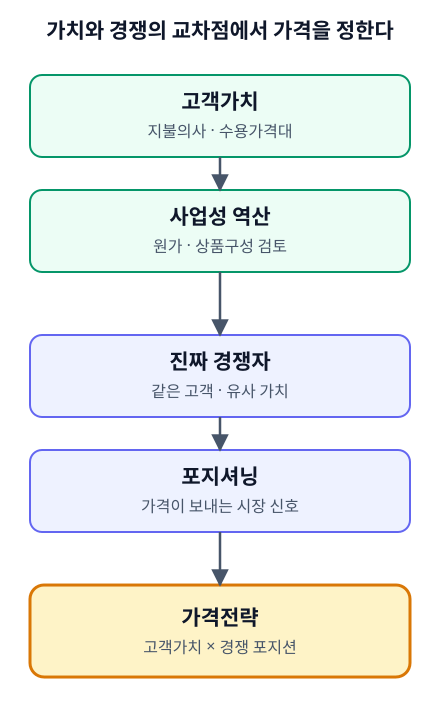

# CH03. 가격결정의 두 논리 — 고객가치와 경쟁

> **발표 핵심 메시지:** 좋은 가격은 고객이 인정하는 가치와 경쟁 속에서 선택할 포지션을 함께 반영한다.

## 1. 학습목표

이 장을 마치면 고객가치 기반 가격결정과 경쟁 기반 가격결정을 서로 다른 논리로 구분할 수 있고, 가격이 단순한 숫자가 아니라 고객에게 품질과 브랜드의 위치를 해석하게 만드는 포지셔닝 신호라는 점을 설명할 수 있다.

## 2. 핵심개념

가격을 정하는 방식에는 최소 두 가지 서로 다른 논리가 있다.

첫째는 고객가치 기반 가격결정이다. 원가를 계산했다고 해서 가격이 자동으로 정해지는 것은 아니다. 고객은 기업 내부에서 들어간 비용을 보상하기 위해 돈을 내지 않는다. 고객이 돈을 지불하는 이유는 그 상품이나 서비스가 자신에게 의미 있는 문제를 해결하거나 원하는 가치를 제공한다고 느끼기 때문이다. 원가가 가격의 현실적인 하한선을 만든다면, 고객이 받아들일 수 있는 지불범위는 가격의 다른 경계를 만든다. 고객가치 기반 가격결정은 원가에서 마진을 더해 가격을 정하는 방식과 달리, 고객이 받아들일 수 있는 가격대와 지불의사를 먼저 파악하고 그 가격에서 사업성이 성립하도록 원가와 상품구성을 역으로 검토하는 방식이다. 이를 위해서는 고객조사와 시장반응 테스트가 필요하다.

둘째는 경쟁 기반 가격결정이다. 경쟁자의 가격을 참고하지만, 단순히 업계 평균가격을 복사하는 방식은 아니다. 먼저 누구와 비교할 것인지부터 정해야 한다. 같은 상품 카테고리에 있다고 해서 모두 실제 경쟁자는 아니다. 경쟁자는 동일한 고객세그먼트에게 유사한 고객가치를 제공하는 솔루션으로 정의된다. 따라서 경쟁가격을 비교하기 전에 고객과 가치, 대체재의 범위를 먼저 정해야 한다.

이 두 논리는 서로 배타적이지 않다. 고객가치 기반 가격결정이 "이 가격을 고객이 받아들일 근거가 있는가"를 묻는다면, 경쟁 기반 가격결정은 "이 가격이 시장에서 어떤 위치로 읽히는가"를 묻는다. 두 질문 모두 가격결정 과정에서 함께 다뤄야 한다.

## 3. 왜 중요한가

가격은 고객의 머릿속에서 만들어지는 포지셔닝과 연결된다. 같은 기능을 가진 상품이라도 고객이 어떤 문제를 해결한다고 인식하는지, 대체재와 비교했을 때 어떤 차별적 가치를 느끼는지, 구매과정에서 어떤 경험을 하는지에 따라 받아들일 수 있는 가격이 달라진다. 가치 기반 가격은 고객이 실제로 인정하는 가치가 무엇인지 확인하고 그 가치가 제품·채널·프로모션 전반에서 일관되게 구현되는지를 점검하는 과정이다.

원자료에서는 부가가치 가격결정을 경쟁사의 가격인하에 그대로 따라가지 않고, 차별화된 가치를 더해 높은 가격을 정당화하는 방식으로 설명한다. 핵심은 할인 자체가 아니라 고객이 체감하는 가치와 기업이 지켜야 할 수익구조를 동시에 설계하는 데 있다.

경쟁 관점에서 보면, 가격은 고객에게 품질과 브랜드의 위치를 해석하게 만드는 신호이기도 하다. 낮은 가격이 시장진입에 유리해 보일 수 있지만, 한 번 저가 브랜드로 인식되면 이후 프리미엄 시장으로 이동하는 데 큰 비용과 시간이 필요할 수 있다. 특히 자원과 인프라가 부족한 스타트업이 규모의 경제를 확보하지 못한 채 저가경쟁에 들어가면 낮은 영업이익률을 감수하면서 성장해야 하고, 그 과정에서 자금과 운영 리스크가 커질 수 있다. 반대로 고가전략도 가격만 올린다고 성립하지 않는다. 높은 가격을 정당화할 제품과 서비스, 고객경험, 채널, 브랜드가 함께 있어야 한다.

## 4. Framework / Logic

두 논리를 하나의 흐름으로 정리하면 다음과 같다.

- 고객가치 기반 가격결정: 고객세그먼트가 상품에 부여하는 가치 → 고객이 받아들일 수 있는 가격대와 지불의사 파악 → 그 가격에서 사업성이 성립하도록 원가·상품구성을 역으로 검토
- 경쟁 기반 가격결정: 동일한 고객세그먼트에게 유사한 가치를 제공하는 솔루션(진짜 경쟁자) 정의 → 그 경쟁자의 가격 비교 → 가격을 통해 어떤 포지셔닝(품질·브랜드 위치)을 전달할지 결정

가격을 높게 책정하고 싶다면 "원가가 높아서"가 아니라 고객이 납득할 수 있는 가치의 근거를 설계하고 증명해야 한다. 가격은 포지셔닝의 결과이면서 동시에 그 포지셔닝을 강화하는 수단이다. 따라서 가격전략을 논할 때는 "얼마 받을 것인가?"보다 "어떤 고객에게 어떤 가치로 기억되고 싶은가?"라는 질문을 함께 던져야 한다.

한 가지는 정직하게 밝혀두어야 한다. 이 두 논리는 가격이 움직일 수 있는 방향과 근거를 설명하지만, **가격의 하한선과 상한선을 실제 숫자로 산정하는 표준 절차는 이 Knowledge Source에서도 확정되어 있지 않다.** 원가가 하한선, 고객의 지불의사가 상한선이라는 개념적 경계는 제시되어 있으나, 이를 구체적인 숫자(예: 원가의 몇 배, 지불의사 조사에서 몇 % 지점)로 환산하는 절차는 원자료에 없다. 따라서 이 교재에서는 숫자 산정 절차를 임의로 지어내지 않는다.

## 5. 적용 절차

1. 대상 고객세그먼트를 정의하고, 그 세그먼트가 상품에서 어떤 문제 해결 또는 가치를 기대하는지 확인한다.
2. 고객조사와 시장반응 테스트를 통해 고객이 받아들일 수 있는 가격대와 지불의사를 파악한다.
3. 그 가격대에서 사업성이 성립하는지 원가와 상품구성을 역으로 검토한다.
4. 동일한 고객세그먼트에게 유사한 가치를 제공하는 진짜 경쟁자(대체재 포함)를 정의한다.
5. 그 경쟁자들의 가격을 비교하되, 업계 평균을 그대로 복사하지 않는다.
6. 이 가격이 고객에게 어떤 포지셔닝 신호(저가/중가/프리미엄)로 읽힐지 검토하고, 제품·서비스·채널·브랜드가 그 신호를 뒷받침하는지 점검한다.
7. 가격 하한선·상한선의 정확한 숫자가 필요한 경우, 현재 이 Knowledge Source에는 표준 절차가 없다는 점을 인지하고 별도 검증이나 후속 자료 확인이 필요함을 기록해둔다.

## 6. Pricing 또는 Harness 적용

현재 Pricing Harness에는 고객가치 기반 가격결정이나 경쟁 기반 가격결정을 직접 계산하는 기능이 없다. 도구 문서상 Value Pricing과 Competitive Pricing은 아직 구현되어 있지 않다. 따라서 이 장의 두 논리는 Harness의 계산식이 근거로 삼는 개념이 아니라, Part III에서 MODE A와 MODE B의 결과를 해석할 때 쓰는 관점이다.

MODE A는 현재 가격에서 실제로 얼마가 남는지(원가 쪽 경계)를 계산하고, MODE B는 목표 공헌이익률을 달성하는 데 필요한 가격을 계산한다. 그러나 두 모드 모두 고객이 그 가격을 받아들일지(가치 경계)나, 그 가격이 경쟁 속에서 어떤 신호가 되는지(경쟁·포지셔닝 신호)는 계산하지 않는다. 이 판단은 이 장에서 정리한 두 축을 가지고 사람이 해야 하며, CH10과 CH11에서 이 연결을 다시 다룬다. 이 장에서는 두 모드의 구체적인 계산 방식을 다루지 않는다.

## 7. 실무 체크포인트

- 가격을 원가에 마진을 더해서만 정하고 있지 않은가?
- 고객이 실제로 인정하는 가치를 조사나 테스트로 확인했는가, 아니면 추정만 하고 있는가?
- "경쟁자"라고 부르는 대상이 실제로 동일한 고객세그먼트에게 유사한 가치를 제공하는 솔루션인가?
- 지금의 가격이 의도한 포지셔닝(저가/프리미엄 등)과 일치하는가?
- 저가전략을 선택했다면, 규모의 경제 없이 낮은 영업이익률을 감수할 준비와 자금 여력이 있는가?
- 고가전략을 선택했다면, 그 가격을 정당화할 제품·서비스·고객경험·채널·브랜드가 실제로 갖춰져 있는가?
- 가격 하한선·상한선을 숫자로 요구받는 상황이라면, 표준 절차가 없다는 사실을 먼저 인지하고 있는가?

## 8. 핵심정리

가격은 원가에 마진을 더한 결과가 아니라, 고객이 인정하는 가치와 시장에서의 포지셔닝이라는 두 논리가 함께 만드는 결과다. 고객가치 기반 가격결정은 고객의 지불의사를 먼저 확인하고 사업성을 역으로 설계하는 방식이며, 경쟁 기반 가격결정은 진짜 경쟁자를 먼저 정의한 뒤 가격을 포지셔닝 신호로 다루는 방식이다. 가격의 하한선과 상한선을 정확한 숫자로 산정하는 표준 절차는 아직 확립되어 있지 않으므로, 이 부분은 임의로 단정하지 않는다.

## 9. 실무 질문

- 우리 상품/서비스에서 고객이 실제로 돈을 지불하는 이유는 무엇인가?
- 우리가 "경쟁자"라고 부르는 곳은 정말 같은 고객에게 같은 가치를 제공하는가?
- 지금의 가격은 우리가 원하는 브랜드 위치와 맞는가, 아니면 습관적으로 정해진 것인가?

## 10. 심화: 표준강의안 보강

이 절은 §1~§9의 두 논리를 설명할 때 쓰는 보조 도구를 더한다. §4에서 밝힌 대로 가격의 하한선·상한선을 숫자로 산정하는 표준 절차는 없으며, 아래 도구도 그 절차를 대신하지 않는다. 가격이 왜 그 수준인지를 설명하는 데 쓰는 틀이다.

### 가격을 움직이는 네 가지 힘

가격은 시장·원가·가치·경쟁이라는 서로 다른 힘의 결과다. 어느 한 가지로만 설명하면 반드시 놓치는 것이 생긴다. 시장(수요와 공급)은 판매자가 통제하기 어려운 힘이고, 가치와 경쟁은 판매자가 설계할 수 있는 힘이다. 시장 가격을 받아들이는 것과 가치로 가격을 만드는 것은 다르다.

### 매출이 큰 쪽이 이익이 큰 것은 아니다

이익은 (가격 − 총원가) × 판매수량이고, 매출액은 가격 × 수량일 뿐이다. 매출을 키우는 가격과 이익을 키우는 가격은 다를 수 있다. 〔실습용 가상자료〕

| 상품 | 가격 | 총원가 | 수량 | 매출 | 영업이익 |
|---|---:|---:|---:|---:|---:|
| A | 10,000원 | 9,500원 | 1,000개 | 10,000,000원 | 500,000원 |
| B | 12,000원 | 8,000원 | 600개 | 7,200,000원 | 2,400,000원 |

A는 매출이 더 크지만 영업이익은 B의 약 5분의 1이다.

### 수요·공급과 균형가격

가격이 오르면 사려는 양(수요)은 줄고 팔려는 양(공급)은 는다. 자유로운 경쟁에서는 실제 가격이 수요곡선과 공급곡선이 만나는 균형가격으로 모인다. 균형보다 높은 가격에서는 공급이 수요를 넘어(초과공급) 재고로, 낮은 가격에서는 수요가 공급을 넘어(초과수요) 품절로 신호가 돌아온다. 초과공급은 가격 인하 압력을, 초과수요는 인상 압력을 만든다. 〔실습용 가상자료〕 아래 식은 설명용 가정이며 실제 수요함수가 아니다.

- 수요량 = 2,400 − 0.1 × 가격
- 공급량 = 0.2 × 가격 − 600

| 가격 | 수요량 | 공급량 | 상태 |
|---:|---:|---:|---|
| 6,000원 | 1,800개 | 600개 | 초과수요 1,200개 |
| 8,000원 | 1,600개 | 1,000개 | 초과수요 600개 |
| 10,000원 | 1,400개 | 1,400개 | 균형 |
| 12,000원 | 1,200개 | 1,800개 | 초과공급 600개 |
| 14,000원 | 1,000개 | 2,200개 | 초과공급 1,200개 |

원재료 가격처럼 판매자가 통제할 수 없는 외부 시장 변수는 비용을 움직여 가격 결정을 흔든다. 그래서 비용이 오르내릴 때의 대응 기준을 미리 정해 두어야 하고, 원가가 변하면 목표가격도 변한다(MODE B). 한편 수요·공급 모형은 판매자가 많고 제품이 같을 때 잘 맞는다. 차별화된 제품, 채널, 고객관계가 있으면 같은 제품도 다른 가격에 팔리므로, 이 모형만으로 가격을 설명하지 않는다. 직접 계산해 보는 연습은 [CH03-EX01](../examples/CH03-EX01-equilibrium-price-excess-supply.md)이다.

### 가치 > 가격과 가격-품질 네 칸

고객은 가치가 가격보다 클 때 산다(Value > Price). 가치가 다른 상품끼리는 가격을 1:1로 단순 비교할 수 없다. 원본 도해는 가치제안(VP)이 더하는 몫을 +Alpha로 표기한다. 가격 포지션은 세로를 품질, 가로를 가격으로 놓은 네 칸으로 볼 수 있다.

| 칸 | 위치(원본 도해 기준) |
|---|---|
| Economy | 왼쪽 위 |
| Skimming | 오른쪽 위 |
| Penetration | 왼쪽 아래 |
| Premium | 오른쪽 아래 |

어느 칸에 서려 하든 그 칸에 필요한 +Alpha를 증거와 함께 설명할 수 있어야 한다. 저가 진입은 한 번 저가 브랜드로 인식되면 프리미엄 이동에 큰 비용이 든다는 §3의 설명과 이어진다.

### 비교가격과 높은 가격의 근거

같은 카테고리에 있다고 자동으로 경쟁자가 되지는 않는다. 같은 고객에게 비슷한 가치를 주는 솔루션만 비교가격의 대상이며, 후보마다 같은 고객인가, 같은 가치인가, 대체재인가를 따져 본다. 동급 최고가는 가격표 숫자만 올려서 만들어지지 않는다. 고가를 부담할 고객만 받는 선택(Target Customer), 특수 채널과 고객관계 관리 집중(Event)이 따라온다.

| 점검 항목 | 확인할 증거 |
|---|---|
| 제품 | 높은 가격을 설명하는 차별점이 있는가 |
| 서비스 | 가격에 걸맞은 서비스가 실제로 제공되는가 |
| 고객경험 | 구매 전후의 경험이 가격을 뒷받침하는가 |
| 채널 | 고가를 부담할 고객에게 닿는 채널이 있는가 |
| 브랜드 | 가격을 정당화하는 브랜드 위치가 있는가 |

"원가가 높아서"는 가격의 근거가 되지 못한다. 증거가 없는 항목은 미확인으로 표시한다.

### 가격을 정하는 네 가지 논리

| 논리 | 출발점 | 놓치기 쉬운 것 |
|---|---|---|
| 원가 기반 | 원가 + 마진 | 고객이 인정하는 가치, 경쟁 위치 |
| 가치 기반 | 고객의 지불의사 | 사업성(원가) 성립 여부 |
| 경쟁 기반 | 진짜 경쟁자의 가격 | 자사의 가치 근거, 업계 평균 복사 위험 |
| 시장 기반 | 수요·공급, 외부 변수 | 차별화된 가치 |

네 논리는 서로 배타적이지 않다. 다만 어느 논리로 정했는지 알아야 가격이 틀렸을 때 어디를 고칠지 안다. 고객이 받아들일 가격대는 추정이 아니라 조사와 시장반응 테스트로 확인하며, 작고 되돌릴 수 있는 방법부터 쓴다. 몇 건이면 충분하다는 보편 기준은 없다(CH15).

### 확인이 필요한 부분

- 가격-품질 네 칸의 정의와 칸별 설명은 원본 도해에 문장이 없고 일반 마케팅 용어 해설에 기댄 것이다. 칸의 위치도 원본 도해 기준이며 일반 통용과 같은지 대조가 필요하다.
- 균형 이탈 시 판매자의 선택에 대한 해설은 일반 경제 개념의 정리이며 교재 인용 대조가 필요하다.
- 네 가지 논리 표 중 시장 기반 행과 "놓치기 쉬운 것" 열은 강의용 정리이다.

- 관련 연습: [CH03-EX01](../examples/CH03-EX01-equilibrium-price-excess-supply.md)

## Source Map
- MN: MN06
- KM: KM046, KM047
- SL: 3-1-03 (이론①: 시장·가치·가격전략)
