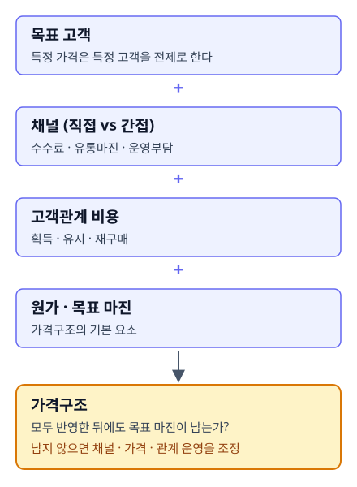
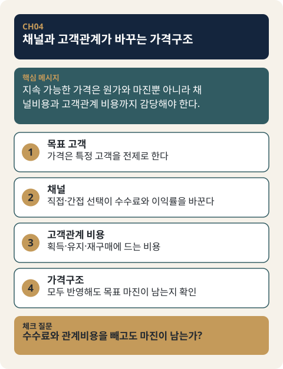

# CH04. 채널과 고객관계가 바꾸는 가격구조

> **발표 핵심 메시지:** 지속 가능한 가격은 원가와 마진뿐 아니라 채널비용과 고객관계 비용까지 감당해야 한다.

## 1. 학습목표

이 장을 마치면 채널 유형(직접채널·간접채널)과 고객관계 비용(획득·유지·재구매)이 가격·마진 구조에 미치는 영향을 설명할 수 있다.

## 2. 핵심개념

가격은 혼자 움직이지 않는다. 특정 가격은 특정 고객을 전제로 하고, 그 고객에게 접근하는 채널을 전제로 하며, 그 채널의 수수료와 운영비는 다시 원가와 마진을 바꾼다. 간접채널(유통사, 플랫폼, 위탁판매 등)을 활용하면 더 넓은 시장에 접근할 수 있지만 유통마진과 수수료가 발생한다. 반대로 직접채널(D2C, 직접 제안영업 등)은 단위당 이익률을 높일 수 있지만, 고객을 스스로 모으고 배송과 서비스까지 감당해야 한다는 부담이 따른다. 어느 한쪽이 항상 우월한 것이 아니라 목표 고객, 상품 특성, 보유 자원, 성장 속도에 맞춰 판단해야 하는 문제다.

가격구조에는 채널비용만이 아니라 고객관계를 유지하는 데 필요한 재원도 들어가야 한다. 고객관계는 친절한 응대에 그치지 않는다. 고객을 획득하고, 구매경험을 관리하고, 재구매와 추가구매로 이어지게 만드는 일련의 활동이며, 여기에는 인력과 시스템, 프로모션 비용이 들어간다. 즉 수익모델이 정립되었다는 말은 가격표를 하나 정했다는 뜻이 아니라, 원가와 마진뿐 아니라 채널비용과 고객관계 유지비용까지 가격구조 안에서 함께 고려했다는 뜻에 가깝다.

## 3. 왜 중요한가

채널을 고려하지 않고 가격을 정하면 팔수록 손해가 나는 구조가 될 수 있다. 수수료와 유통마진을 빼고 나면 실제로 손에 남는 돈이 원가조차 감당하지 못하는 경우가 생기기 때문이다. 같은 이유로, 고객관계 유지비용(획득·유지·재구매 비용)을 가격구조에 반영하지 않으면 겉으로는 마진이 남는 것처럼 보여도 실제로는 지속 가능하지 않은 가격일 수 있다. 채널과 고객관계는 서로 다른 요소이지만, 둘 다 "얼마에 팔 것인가"라는 질문 이전에 "이 가격이 누구에게, 어떤 경로로, 어떤 관계를 통해 전달되는가"를 먼저 묻게 만든다는 점에서 같은 원칙을 공유한다.

## 4. Framework / Logic

두 KM이 공유하는 논리 구조는 다음과 같다.

1. 가격은 고정된 숫자가 아니라 비즈니스모델의 다른 요소(고객, 채널, 생산능력, 주문량, 관계비용, 파트너)에 의해 계속 수정되는 전략변수다.
2. 채널 선택(직접 vs 간접)은 시장 접근성과 단위당 이익률 사이의 트레이드오프를 만든다.
3. 고객관계 유지비용(획득·유지·재구매)은 원가·마진과 별개로 존재하는 비용 항목이며, 가격구조 설계 시 함께 반영해야 한다.
4. 같은 제품이라도 채널구조와 고객관계 비용이 달라지면 적정 가격과 마진 구조도 달라진다.

## 5. 적용 절차

1. 목표 고객과 상품 특성을 확인하고, 이 고객에게 접근 가능한 채널(직접/간접)을 나열한다.
2. 채널별 수수료·유통마진·운영부담을 확인한다.
3. 고객 획득·유지·재구매에 필요한 활동(인력, 시스템, 프로모션)과 그 비용을 확인한다.
4. 원가, 채널비용, 고객관계 유지비용을 모두 반영했을 때도 목표 마진이 남는지 검토한다.
5. 남지 않는다면 채널 구성, 가격, 또는 고객관계 운영방식 중 무엇을 조정할지 판단한다.

## 6. Pricing 또는 Harness 적용

Pricing Harness(pricing-harness-public) 도구의 `core/schemas/client_input.schema.json`에는 `cost_item.applies_to_component`, `allocation_rule` 필드가 스키마 수준으로 정의되어 있어, 향후 비용 항목을 채널이나 구성요소별로 배분할 수 있는 구조적 여지는 마련되어 있다. 그러나 현재 시점에서 채널별 비용 배분을 실제로 계산·분석하는 기능은 구현되어 있지 않다. 즉 이 필드는 아직 입력 스키마에만 존재하며, 이를 활용해 채널별 마진이나 수수료 영향을 자동 산출하는 분석 로직은 없다. 이 장의 내용을 실무에 적용할 때는 현재로서는 수기 또는 별도 스프레드시트로 채널별 원가·수수료·고객관계 비용을 정리해야 하며, Harness가 이를 자동화해줄 것으로 기대해서는 안 된다. 이는 현재 도구의 한계이며, 향후 개발이 필요한 영역으로 별도 기록해 둘 필요가 있다.

## 7. 실무 체크포인트

- 채널별 수수료·유통마진을 가격 설계 이전에 확인했는가.
- 직접채널 운영에 필요한 고객 획득·배송·서비스 역량을 실제로 보유하고 있는가.
- 고객 획득·유지·재구매에 드는 인력·시스템·프로모션 비용을 가격구조에 반영했는가.
- 채널구조나 주문량이 바뀌었을 때 가격을 재검토하는 절차가 있는가.

## 8. 핵심정리

가격은 원가와 목표 마진만으로 정해지지 않는다. 채널의 수수료·유통마진과 고객관계를 유지하는 데 드는 비용까지 반영해야 실제로 지속 가능한 가격구조가 만들어진다. 채널과 고객관계는 가격이 계속 검토되어야 하는 전략변수임을 보여주는 두 축이다.

## 9. 실무 질문

- 우리 제품/서비스는 어떤 채널(직접/간접)을 통해 고객에게 전달되고 있으며, 그 채널의 수수료 구조는 얼마인가?
- 고객을 획득하고 재구매로 이어지게 만드는 데 실제로 얼마의 비용이 들고 있으며, 이는 현재 가격구조에 반영되어 있는가?

## 10. 심화: 표준강의안 보강

### 가격구조의 용어와 등식

권장 소비자가(List price)에서 할인 프로그램을 빼면 실판매가(Sales price)가 되고, 실판매가는 총원가와 이익으로 나뉜다. 총원가는 다시 판관비와 원가로 나뉜다. 즉 `실판매가 = 이익 + 총원가`, `권장가 = 할인 프로그램 + 이익 + 총원가`이다. 원본 도해의 상대 비율(권장가 100)로 읽으면 다음과 같다.

| 항목 | 값(권장가 100) | 실판매가 대비 |
|---|---|---|
| 권장가 | 100 | - |
| 할인 프로그램 | 15 | - |
| 실판매가 | 85 | 100% |
| 이익 | 10 | 11.8% |
| 총원가 | 75 | 88.2% |
| 판관비 | 40 | 47.1% |
| 원가 | 35 | 41.2% |

비율의 기준은 항상 실판매가로 통일한다. 여기서의 이익은 판관비까지 뺀 값이므로, 판매·배송 변동비까지만 뺀 공헌이익과 이름을 섞지 않는다. 판관비 40을 변동 15와 고정 25로 나누면(설명을 위한 가정) 85 − 35 − 15 = 35가 공헌이익, 35 − 25 = 10이 이익이 되어 고정비가 따로 드러난다. 같은 구조를 손익계산서로 옮기면 실판매가 한 줄이 매출의 첫 줄이 된다. 가상 단가(권장가 20,000원, 월 500개)로 계산하면 실판매가 17,000원, 매출 8,500,000원, 매출총이익 5,000,000원, 영업이익 1,000,000원이다. 〔실습용 가상자료〕

이 구조는 거꾸로도 읽을 수 있다. 권장가 20,000원, 할인 15%, 목표 이익률 25%이면 실판매가 17,000원, 목표 이익 4,250원, 쓸 수 있는 총원가는 12,750원이다. 〔실습용 가상자료〕 연습은 [CH04-EX05](../examples/CH04-EX05-price-structure-table.md)를 본다.

### 판매 계약 방식과 매출 인식

같은 100원 판매라도 판매가 전체가 매출이 되는 방식(직매입)과 수수료만 매출이 되는 방식(특정매입)이 있다. 채널을 비교할 때는 가격표뿐 아니라 수익 인식 기준을 맞춘 뒤에 비율을 비교해야 한다.

### 채널 구조와 단계별 마진

채널은 제조사가 구매자에게 직접 파는 길, 도매를 거쳐 소매로 가는 길, 설치업체를 거치는 길, 재고를 정리하는 클리어런스 길로 나뉜다. 구매자(Buyer)는 소비자(Consumer)·사용자(User)와 같지 않을 수 있다. 제조사는 "얼마에 공급할까"를, 유통사는 "얼마에 받아와야 하나"를 묻고, 가격은 두 질문이 만나는 곳에서 정해진다.

단계마다 마진이 붙으면 제조사 몫은 소비자가의 일부가 된다. 소비자가 10,000원, 소매 마진 30%(소매가 기준), 도매 마진 15%(도매 판매가 기준)를 가정하면 다음과 같다. 〔실습용 가상자료〕

| 단계 | 판매가 | 마진율 | 마진액 | 매입가 |
|---|---|---|---|---|
| 소매 | 10,000 | 30% | 3,000 | 7,000 |
| 도매 | 7,000 | 15% | 1,050 | 5,950 |

제조사 공급가 5,950원은 소비자가의 59.5%이다. 마진율의 기준(판매가 기준인지 매입가 기준인지)을 통일하지 않으면 계산이 어긋난다. 소셜 미디어처럼 채널 안의 주체(영업 프로그램, 크리에이터)가 바뀌어도 `가격 = 할인 프로그램 + 이익 + 총원가`라는 기본 구조는 같고, 유통 몫이 수수료로 바뀔 뿐이다.

### 가격 산정의 세 방식

| 방식 | 먼저 고정하는 것 | 요지 |
|---|---|---|
| Cost plus | 원가 | 제조업체가 원가에 판관비와 이익을 쌓아 가격을 정한다 |
| Sales minus | 포지셔닝 가격 | 가격에서 채널 마진·이익·판관비를 빼 허용 원가를 구한다 |
| Keystone | 유통 흐름의 배수 | 패션에서 배수로 가격을 정한다. 배수는 업종마다 같지 않다 |

어느 방식이든 가격구조의 같은 칸을 다른 순서로 채우는 것이다. Sales minus의 핵심 경고는 "해당 원가구조로 소싱이 되지 않으면 팔 수 없다"는 것이다. 허용 원가보다 실제 원가가 높다면 원가 절감, 구성 변경, 차별화를 통한 가격 방어, 목표율 재검토 중에서 선택한다. 계산 연습은 [CH04-EX04](../examples/CH04-EX04-channel-margin-sales-minus.md)를 본다. 여기서의 이익률은 실판매가(공급가) 기준의 단순 계산이다.

### 세 사례의 가격구조 비교

CH04-EX01~03의 원본 도식 값을 실판매가 100%로 맞추어 다시 계산하면 거래유형별 구조의 무게가 보인다. 도식의 정수 표기와는 1% 안팎의 차이가 있다.

| 항목 | B2C | B2B | B2G |
|---|---|---|---|
| 권장가 → 실판매가 | 19,000 → 15,900원 | 1,500 → 1,250원 | 132 → 110만 원 |
| 제조원가율 | 56.6% | 66.6% | 30.9% |
| 판관비율 | 15.0% | 9.0% | 30.0% |
| 총원가율 | 71.6% | 75.5% | 60.9% |
| 마진율 | 28.4% | 24.5% | 39.1% |

B2C는 제조원가율이 높아 유통단계를 줄이는 직판이 필요했다. B2B는 판관비율이 낮아 규모의 경제가 관건이다. B2G는 판관비율이 높아 관계·신뢰·조달 대응 비용이 구조에 들어 있다. B2B에서 할인 없이 공식납품가로 팔면 마진이 1,500 − 944 = 556원이지만 20% 할인 후에는 306원으로 약 45% 줄어, 할인은 물량 조건과 묶어 두어야 한다.

### 프로모션 재원: List price와 Sales price의 차이

개당 프로모션 비용은 `List price − Sales price`이고, 연간 예산은 여기에 월 생산량과 12개월을 곱한다(로스율 없이 전량 판매한다는 전제). B2C는 19,000 − 15,900 = 3,100원, B2B는 1,500 − 1,250 = 250원, B2G는 22만 원 × 500대 × 12개월 = 13억 2,000만 원이다. 쓰지 않은 재원은 마진으로 돌아오므로 고객관계 재원은 가격구조 안에서 미리 정해 두어야 한다. 연습은 [CH04-EX06](../examples/CH04-EX06-list-sales-promotion-fund.md)를 본다. 기존 사례 [EX01](../examples/CH04-EX01-vegan-chocolate-d2c.md), [EX02](../examples/CH04-EX02-cosmetics-container-b2b.md), [EX03](../examples/CH04-EX03-groundwater-b2g.md)와 함께 읽는다.

### 확인이 필요한 부분

- 입점계약 방식별 수수료율, Keystone 배수, 채널 마진율 등 인용·예시 숫자는 인용 시점 또는 연습용 가정이며 현재 조건이 아니다.
- B2G 도식의 마진 칸 "33만 원"은 110 − 67 = 43만 원과 맞지 않아 표기 오류로 보인다. B2C의 CR 비용 3,180원과 19,000 − 15,900 = 3,100원도 80원 차이가 난다.

## Source Map
- MN: MN06
- KM: KM048, KM049
- SL: 3-1-04 (이론② 가격구조·채널구조), 3-1-06 (사례 3종), 3-1-09 (N-15 문항 3~5)
