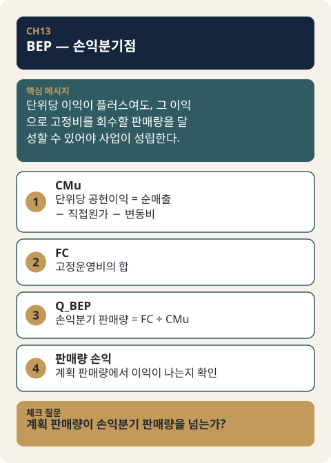

# CH13. BEP — 손익분기점

> **발표 핵심 메시지:** 단위당 이익이 플러스여도, 그 이익으로 고정비를 회수할 판매량을 달성할 수 있어야 사업이 성립한다.

## 1. 학습목표

현재 가격·공헌이익(Contribution Margin) 구조에서 고정비를 회수하는 데 필요한 판매수량을 계산할 수 있다.

## 2. 핵심개념

BEP(Break-Even Point, 손익분기점)는 "현재 가격과 Contribution Margin 구조에서 고정운영비를 회수하려면 몇 단위를 판매해야 하는가?"라는 질문에 답하는 계산이다. 단위당 공헌이익(CMu, Contribution Margin per unit)이 아무리 양수라 하더라도, 고정운영비(FC, fixed operating cost)가 그에 비해 충분히 크면 사업 전체로는 손실이 날 수 있다. 즉 단위당으로는 "남는" 가격이라도, 그 마진으로 고정비를 다 회수하지 못하면 사업은 아직 성립하지 않는다. BEP는 이 지점 — 고정비가 정확히 회수되는 판매수량 — 을 계산한다.

공식은 단순하다.

```
CMu = N − direct_cost − variable_cost_total   (MODE A와 동일한 Contribution Margin 정의)
FC  = 해당 컴포넌트·분석기간의 고정운영비 합계
Q_BEP = FC / CMu
```

여기서 N은 VAT 제외 기준의 현재 실제 판매가(actual price)다. BEP는 MODE A/B/C 중 MODE A와 동일하게 "지금 이 가격"만을 다룬다 — 목표가격(MODE B)이나 시장가격(MODE C)을 대신 넣어 계산하는 것은 BEP v0.1의 범위 밖이며, 향후 별도의 Scenario Compare 모듈에서 다루도록 설계되어 있다.

## 3. 왜 중요한가

가격전략을 세울 때 흔히 저지르는 실수는 "단위당 마진이 플러스면 팔수록 이득"이라고 단순화하는 것이다. 그러나 고정비가 존재하는 한, 실제로 이득이 나려면 일정 수량 이상을 팔아야 한다. BEP는 이 "일정 수량"을 구체적인 숫자로 드러내, 사업 실행 가능성(feasibility)을 정성적 판단에서 정량적 판단으로 옮겨준다. 이는 KM060이 말하는 QCD(Quality·Cost·Delivery) 검토 중 Cost 축의 핵심 질문 — "감당 가능한 비용으로 만들어낼 수 있는가" — 을 구체적인 판매수량 단위로 검증하는 도구이기도 하다. 비용을 계산한 결과가 팔수록 손해가 나는 구조라면, 품질과 전달 조건을 충족하더라도 사업으로 성립하지 않는다는 KM060의 원칙을, BEP는 "몇 개를 팔아야 손해가 아닌가"라는 실무적 숫자로 바꿔 보여준다.

## 4. Framework / Logic

BEP는 두 가지 입력만을 필요로 한다 — 현재 가격의 Contribution Margin 구조(MODE A와 동일한 방식으로 독립 재계산), 그리고 고정운영비. `docs/features/bep/SPEC.md`는 이를 다음과 같이 정리한다.

- **CMu(단위당 공헌이익)**: MODE A의 Contribution Margin 정의를 그대로 따른다. `N − direct_cost − variable_cost_total`. BEP는 MODE A의 계산 결과를 그대로 읽어오는 것이 아니라, `client_input`으로부터 동일한 로직(`core/engine/economics.py`의 `price_converted`, `sum_cost_category`)을 사용해 독립적으로 재계산한다. 이렇게 설계한 이유는, 향후 목표가격이나 시장가격을 넣어 BEP를 계산하는 Scenario Compare 기능이 추가될 때 MODE A의 결과 객체에 의존하지 않고도 확장 가능하도록 하기 위함이다.
- **FC(고정운영비)**: `cost_category = "fixed_operating_cost"`인 항목들의 합. 이 항목은 MODE A/B/C가 전혀 읽지 않던 항목이므로, BEP가 처음으로 다루는 비용 범주다.
- **CMu의 부호에 따른 결과 처리**: CMu > 0이면 `Q_BEP = FC / CMu`가 정상적으로 계산된다(OK). CMu = 0이거나 CMu < 0이면, 어떤 판매수량으로도 손익분기에 도달할 수 없거나(margin=0) 팔수록 손실이 커지는 구조(margin<0)이므로, `break_even_quantity_exact`는 값이 없는 상태(`NOT_APPLICABLE`)로 표시되고 그 이유를 설명하는 경고가 함께 출력된다. 이 값은 "계산 불가(UNKNOWN)"도 "오류(ERROR)"도 아니라, 입력값은 모두 알고 있지만 "손익분기 판매량"이라는 개념 자체가 이 가격·비용구조에서는 성립하지 않는다는 뜻이다.
- **고정비가 0이거나 아예 없는 경우**: 고정비 항목이 전혀 없거나 명시적으로 0으로 입력된 경우 FC=0으로 확정(OK)되며, CMu>0이면 Q_BEP=0이 된다. 이는 "고정비가 없으므로 첫 단위부터 손익분기"라는 정상적이고 의미 있는 결과다.
- **다중 컴포넌트 제한**: 상품이 두 개 이상의 가격 컴포넌트(price_components)로 구성된 경우, BEP v0.1은 계산을 아예 수행하지 않고 `ERROR`(코드: `MULTI_COMPONENT_BEP_NOT_SUPPORTED`)를 반환한다. 이는 공유 고정비(shared fixed cost)를 컴포넌트별로 중복 계산하거나 잘못 배분하는 것을 막기 위한 구조적 제한이다.
- **공유 고정비의 `blended_only` 처리**: 공유 비용 항목 중 `allocation_rule = "blended_only"`인 경우, MODE A/B/C에서는 이 비용을 계산에서 제외(0으로 취급)하지만, BEP는 고정비 자체가 분자이기 때문에 이를 `UNKNOWN`으로 처리한다(0으로 취급하면 실제 존재하는 고정비를 조용히 누락시키는 결과가 되기 때문). SPEC.md 4장의 확인에 따르면, 현재 존재하는 예시 Client Input 4건 모두 고정비를 `shared`+`blended_only`로 입력하고 있어, 실무에서는 이 UNKNOWN 케이스가 오히려 흔하게 나타날 수 있다.

## 5. 적용 절차

1. 대상 상품의 가격 컴포넌트가 단일 컴포넌트인지 확인한다. 두 개 이상이면 BEP v0.1로는 계산할 수 없다.
2. 현재 실제 판매가(actual price)를 VAT 기준에 맞추어 N(VAT 제외 순매출)으로 환산한다.
3. 해당 컴포넌트의 직접원가(product_service_direct_cost)와 변동비(variable_selling_delivery)를 합산해 CMu를 계산한다.
4. 해당 컴포넌트에 귀속되는 고정운영비(fixed_operating_cost) 항목을 모두 합산해 FC를 구한다. 이때 항목들의 `basis`(분석기간, 예: `per_month`)가 서로 일치하는지 확인한다 — 일치하지 않으면 계산할 수 없다.
5. CMu의 부호를 확인한다. 0보다 크면 `Q_BEP = FC / CMu`를 계산한다. 0 이하이면 손익분기 판매량이 정의되지 않는다는 결론을 내리고 그 이유를 함께 기록한다.
6. 산출된 Q_BEP가 의미하는 "판매수량"이 FC의 `basis`가 나타내는 분석기간(예: 한 달) 내의 수량이라는 점을 함께 표기한다.

## 6. Pricing 또는 Harness 적용

Pricing Harness는 BEP를 `core/engine/modes/bep.py`의 `run_bep(client_input)` 함수로 구현하고 있으며, 다른 모드(MODE A/B/C)와 동일하게 `client_input`만을 입력받는 균일한 시그니처를 사용한다. 내부적으로는 `core/engine/economics.py`의 공유 primitive(`price_converted`, `sum_cost_category`)를 MODE A와 공동으로 사용하고, 고정운영비 집계(`sum_fixed_operating_cost`)도 같은 파일의 공유 함수로 호출하되(이 집계 함수는 아래의 Volume Profit 모듈도 함께 사용한다), `mode_a.py`를 직접 참조하지 않는다 — 이는 향후 목표가격·시장가격을 대입하는 Scenario Compare 기능을 만들 때 BEP가 특정 모드의 결과 객체에 종속되지 않도록 하기 위한 설계다. `docs/features/bep/SPEC.md`와 `docs/features/bep/CASE.md`는 이 계산 로직과 23개의 테스트 케이스(TC1~TC23)를 상세히 정의하고 있으며, `tests/test_bep.py`(541줄)에 실제 자동화 테스트가 구현되어 있다. 실무에서 이 도구를 활용할 때는, 현재 판매가의 Contribution Margin 구조(MODE A 결과)와 고정운영비 입력값이 정확할수록 BEP 결과의 신뢰도가 높아진다는 점, 그리고 다중 컴포넌트 상품이나 공유 고정비가 `blended_only`로만 입력된 경우에는 v0.1 범위에서 계산 자체가 제한된다는 점을 미리 파악하고 있어야 한다.

**BEP 다음 질문 — 계획 판매량에서의 손익(Volume Profit).** BEP는 판매수량을 입력이 아니라 결과(Q_BEP)로만 내놓는다. 그래서 "월 500개를 팔면 얼마가 남는가", "지금 물량은 손익분기 대비 안전한가"에는 답하지 못한다. Pricing Harness는 이 질문을 별도 모듈 Volume Profit으로 다룬다(`core/engine/modes/volume_profit.py`의 `run_volume_profit(client_input)`, 명세는 `docs/features/volume_profit/SPEC.md`). 이 모듈은 Harness에서 수량을 입력으로 받는 유일한 기능이다. Client Input의 `sales_plan`(`planned_quantity`, `period_basis`)에 계획 판매량 Q를 넣으면, 현재 판매가에서 Q개를 팔았을 때의 기간 영업이익과 손익분기 판매량 대비 여유(안전한계)를 계산한다.

```
operating_profit          = CMu × Q − FC
margin_of_safety_quantity = Q − Q_BEP
margin_of_safety_rate     = (Q − Q_BEP) / Q
```

CMu, FC, Q_BEP는 이 장의 BEP와 같은 정의를 그대로 쓴다. 고정비를 단위당으로 나눠 배분하지 않는다는 점도 같다. 실무에서 알아 둘 범위와 처리 규칙은 다음과 같다.

- `sales_plan`이 아예 없으면 이 모듈은 오류가 아니라 `NOT_RUN`이다(아직 이 질문을 하지 않았다는 뜻). `sales_plan`은 있는데 `planned_quantity`가 `null`이면 `UNKNOWN`이다. `planned_quantity = 0`은 "판매 없음"이라는 유효한 계획이며 영업이익은 −FC가 된다.
- 계획 판매량의 기간은 현재 `per_month`(월)만 지원한다. 고정운영비 항목의 `basis`도 `per_month`여야 하며, 다른 `basis`이면 `ERROR`(`UNSUPPORTED_FIXED_COST_BASIS_FOR_VOLUME`)가 된다.
- BEP와 마찬가지로 단일 가격 컴포넌트만 지원한다. 두 개 이상이면 `ERROR`(`MULTI_COMPONENT_VOLUME_PROFIT_NOT_SUPPORTED`)다.
- 계획 판매량이 Q_BEP에 못 미치면 안전한계는 음수 그대로 표시된다. 값을 0으로 자르지 않고, 상태는 `OK`를 유지하면서 `BELOW_BREAK_EVEN` 경고가 붙는다. BEP는 CMu ≤ 0이면 값을 내지 않는 것과 대비된다.
- 직접원가·변동비 중 `basis = "per_order"`인 항목이 있으면, 주문당 1개를 판매한다고 가정하고 계산한다. 이 경우 `CMu × Q`에 의존하는 지표는 `ESTIMATED` 상태와 `ASSUMES_ONE_UNIT_PER_ORDER` 경고를 갖는다. 주문당 구매 수량이 1개보다 크면 비용이 과대 계상되고 영업이익은 과소 계상된다.
- 이 모듈은 수요를 예측하지 않는다. `planned_quantity`는 외부에서 주어지는 입력일 뿐이며, 가격이 바뀔 때 수량이 어떻게 반응하는지는 모델링하지 않는다.
- Scenario Compare(CH14)에는 아직 포함되어 있지 않다.

BEP와 마찬가지로 Volume Profit의 영업이익·안전한계 산식과 상태 규칙은 Master Note가 정의한 개념이 아니라 Pricing Harness의 내부 규격(Internal Specification)이다. Master Note가 뒷받침하는 것은 사업타당성을 "특정 가격과 특정 수량에서" 판단해야 한다는 문제의식까지다.

## 7. 실무 체크포인트

- CMu가 0 이하인 채로 상품을 출시하려 하고 있지는 않은가? BEP 계산 이전에, 단위당 마진 자체가 마이너스이거나 0이라면 판매량을 아무리 늘려도 손익분기에 도달할 수 없다.
- 고정운영비 항목의 `basis`(월간/건별/방문당 등)가 서로 다른 항목들을 무심코 합산하고 있지는 않은가? basis가 다르면 합산 자체가 불가능하다.
- 상품이 다중 컴포넌트 구조라면, 이 Chapter가 다루는 BEP v0.1 계산이 아직 지원되지 않는다는 점을 인지하고 있는가.
- 공유 고정비가 있다면 그 배분 규칙(`allocation_rule`)이 무엇인지 확인했는가 — `blended_only`인 경우 BEP는 그 비용을 계산에 반영하지 못한 채 UNKNOWN으로 남긴다.
- 산출된 Q_BEP는 반올림되지 않은 정확한 수치이며(예: 104.68단위), "몇 개를 팔아야 하는가"를 실무적으로 표현할 때 올림 처리를 할지는 이 수치를 받아 쓰는 보고서·대시보드 단계에서 별도로 판단해야 한다(엔진 자체는 반올림 정책을 갖지 않는다).
- 계획 판매량에서의 손익을 확인하려 한다면(Volume Profit), 그 수량이 월 단위이고 고정운영비의 `basis`도 월 단위(`per_month`)인지 확인했는가. `per_order` 비용이 있다면 "주문당 1개 판매" 가정이 실제 구매 패턴에 맞는지도 확인해야 한다.
- KM062가 설명하듯, 판매수량(Qty)의 의미는 B2C·B2B·B2G에 따라 전혀 다른 근거로 산출된다. BEP가 계산하는 Q_BEP는 "몇 단위를 팔아야 손익분기인가"라는 산술적 목표수량일 뿐이며, 이 숫자가 실제로 달성 가능한지는 거래유형별 Qty 산정 근거(예: B2C의 타깃고객 수×구매빈도, B2B의 발주규모, B2G의 예산·법적 의무)와 별도로 검증해야 한다.

## 8. 핵심정리

BEP는 현재 가격의 Contribution Margin 구조와 고정운영비만을 입력으로 받아, 손익분기에 도달하는 데 필요한 판매수량(Q_BEP = FC / CMu)을 계산하는 도구다. 단위당 마진이 플러스라는 사실만으로는 사업성을 판단할 수 없으며, 그 마진으로 고정비를 회수하는 데 필요한 구체적 판매수량을 확인해야 비로소 실행 가능성을 정량적으로 점검할 수 있다. BEP v0.1은 단일 가격 컴포넌트 상품만 지원하며, CMu가 0 이하인 경우나 공유 고정비가 완전히 배분되지 않은 경우처럼 계산이 성립하지 않거나 불확실한 상황을 값 대신 명확한 상태 코드(NOT_APPLICABLE/UNKNOWN/ERROR)와 경고 메시지로 드러낸다.



## 9. 실무 질문

- 현재 판매가에서 CMu는 얼마이며, 그 부호는 손익분기 판매량이 정의될 수 있는 구조인가?
- 이 상품에 귀속되는 고정운영비는 어떤 항목들로 구성되며, 그 분석기간(basis)은 서로 일치하는가?
- Q_BEP로 산출된 판매수량은, 이 상품의 거래유형(B2C/B2B/B2G)에서 실제로 달성 가능한 수량인가?
- 이 상품이 다중 컴포넌트 구조이거나 공유 고정비를 갖고 있다면, 그로 인해 BEP 계산 자체가 제한되거나 불확실해지는 지점은 어디인가?

## 10. 심화: 표준강의안 보강

### 가격이 바뀔 때 손익분기와 판매량 손익이 움직이는 크기

CMu와 FC만 알면 가격별 BEP와 계획 판매량의 영업이익을 한 표로 비교할 수 있다. 수제 쌀쿠키 6개입 세트(VAT 포함가, 직접원가 6,000원, 택배 3,000원, 수수료는 실지급액의 5%, 월 고정운영비 600,000원, 계획 월 250세트)를 가정한다. 〔실습용 가상자료〕

| 판매가 | 순매출(N) | 변동비 | CMu | Q_BEP | 250세트 영업이익 | 안전한계(수량) |
|---|---|---|---|---|---|---|
| 12,000원 | 10,909.09 | 3,600 | 1,309.09 | 458.3 | −272,727 | −208.3 |
| 15,000원 | 13,636.36 | 3,750 | 3,886.36 | 154.4 | 371,591 | 95.6 (38.2%) |
| 18,000원 | 16,363.64 | 3,900 | 6,463.64 | 92.8 | 1,015,909 | 157.2 |

가격을 20% 내리면 CMu는 약 3분의 1(3,886 → 1,309)로 줄고 손익분기 수량은 약 3배(154.4 → 458.3)가 된다. 고정비는 그대로인데 단위당 마진이 얇아지기 때문이다. 12,000원에서는 계획 판매량이 손익분기에 못 미쳐 안전한계가 음수가 되고 `BELOW_BREAK_EVEN` 경고가 붙는다. 반대로 18,000원에서는 월 150세트만 팔아도 영업이익이 369,545원으로, 15,000원·250세트(371,591원)와 비슷하다. 다만 가격이 달라질 때 수량이 어떻게 변하는지는 계산이 아니라 가정이며, Volume Profit은 이를 모델링하지 않는다(§6).

### 손익분기를 읽는 다섯 상황

| 상황 | 결과 | 읽는 법 |
|---|---|---|
| CMu > 0, FC 확정 | `Q_BEP = FC / CMu`, `OK` | 분석기간(예: 월)의 판매수량이다 |
| CMu ≤ 0 | `NOT_APPLICABLE` + 경고 | 입력은 다 알지만 손익분기 개념이 성립하지 않는다. 수량보다 가격·원가·수수료 구조를 먼저 바꾼다 |
| 고정비 항목이 없거나 0으로 입력됨 | FC = 0 확정, CMu > 0이면 `Q_BEP = 0` | 첫 단위부터 손익분기다 |
| 고정비 항목은 있는데 금액이 비어 있음 | `UNKNOWN` | 지금은 답할 수 없다. 항목을 지우지 말고 모름으로 두고 확인 방법을 적는다 |
| 고정비 항목의 `basis`가 서로 다름 / 가격 구성요소 둘 이상 | 계산하지 않음 / `ERROR` | 기간을 월로 통일한다. 구성요소가 둘 이상이면 하나씩 따로 입력해 각각 읽을 수 있으나 그 결과를 합산하는 방법은 핸드북에 없다 |

CMu ≤ 0의 예. 판매가 9,000원(VAT 포함), 직접원가 6,000원, 택배 3,000원, 수수료 5%(450원)이면 N = 8,181.82, CMu = 8,181.82 − 6,000 − 3,450 = −1,268.18원이다. 값이 없는 상태이며 `UNKNOWN`도 `ERROR`도 아니다. 〔실습용 가상자료〕 "항목이 없다"(확정된 0)와 "항목은 있는데 값이 비었다"(`UNKNOWN`)를 구분하는 것은 표에서 칸을 지운 것과 칸을 비워 둔 것의 차이를 구분하는 일이다.

### 계획 판매량 미달과 주문당 비용의 영향

위 쌀쿠키(15,000원)가 월 100세트만 팔리면 영업이익은 3,886.36 × 100 − 600,000 = −211,364원이고 안전한계는 100 − 154.4 = −54.4세트다. 값은 음수 그대로 표시되고 상태는 `OK`를 유지하며 경고만 붙는다(§6). 택배 3,000원이 `per_order`이면 주문당 1개 판매를 가정하므로 지표가 `ESTIMATED`가 된다. 극단적으로 모든 주문이 2세트라면 세트당 택배비는 1,500원이어서 CMu가 5,386.36원이 되고 250세트의 영업이익은 371,591원에서 746,591원으로 달라진다. 모든 주문이 2세트라는 것은 설명을 위한 극단 가정이다. 〔실습용 가상자료〕 §6이 밝힌 대로 주문당 구매 수량이 1개보다 크면 비용이 과대 계상되고 영업이익은 과소 계상된다. 연습은 [CH13-EX03](../examples/CH13-EX03-volume-profit-practice-problem.md)을 본다.

### 거래유형별 월 손익분기 — 제조 사례

업력 1년차 반려묘 캣타워 업체의 2차 펀딩가 545,000원, 개당 제조원가 389,000원, 월 고정성 비용 8,000,000원(월 60개 양산 기준)을 원문 값으로 두고 가격안별 월 손익분기를 계산하면 다음과 같다. 공헌이익은 제조원가만 뺀 값이다(수수료·배송비 정보는 문제에 없다).

| 가격안 | 개당 공헌이익 | 월 손익분기 | 월 60개 대비 안전한계율 | 월 60개 영업이익 |
|---|---|---|---|---|
| 545,000원 (2차 펀딩가) | 156,000 | 51.3개 | 14.5% | 1,360,000 |
| 572,250원 (+5%) | 183,250 | 43.7개 | 27.2% | 2,995,000 |
| 626,750원 (+15%) | 237,750 | 33.7개 | 43.9% | 6,265,000 |
| 654,000원 (+20%) | 265,000 | 30.2개 | 49.7% | 7,900,000 |

545,000원에서는 월 60개 계획의 안전한계가 15% 정도뿐이다. 양산 200개 안(개당 제조원가 311,200원, 월 영업이익 35,760,000원)에서는 고정성 비용을 11,000,000원으로 역산하면 손익분기가 47.0개, 안전한계율이 76.5%가 된다. 고정비는 37.5% 늘었는데 개당 공헌이익이 49.9% 늘고 수량이 커져 영업이익이 약 26배가 된다. 그러나 손익분기는 "몇 개를 팔아야 하는가"일 뿐이며, 200개가 실제로 팔린다는 근거는 거래유형별 Qty 산정 근거로 따로 검증해야 한다(§7).

### 목표 판매량으로 거꾸로 계산하기

"한 달에 최소 얼마를 벌어야 하는가"에서 출발하면 같은 구조가 거꾸로 쓰인다. 목표 매출은 고정비(생활에 필요한 몫과 사업에 필요한 몫), 변동비, 원하는 순수익을 더한 값이다. 변동비는 판매량에 비례하므로 실제 계산은 1개당 이익(판매가 − 1개당 변동비)을 쓴다.

```
월 최소 판매량         = 월 고정비 / 1개당 이익            (= FC / CMu)
순수익을 포함한 판매량 = (월 고정비 + 원하는 순수익) / 1개당 이익
상품이 여러 개이면     = 월 고정비 / (판매 비중으로 가중평균한 1개당 이익)
```

월 고정비 590만 원, 1개당 이익 3,000원이면 1,966.7잔(올림 1,967잔)이고, 원하는 순수익 50만 원을 더하면 약 2,133.3잔이다. 판매 비중을 가정해 평균 1개당 이익을 쓰는 방식은 핸드북이 정의한 계산이 아니라 같은 식의 수기 적용이다. 이 수량은 생존에 필요한 최소 목표이고, 달성 가능성은 별도로 검증한다. 연습은 [CH13-EX04](../examples/CH13-EX04-cafe-minimum-sales-target.md)를 본다.

### 확인이 필요한 부분

- 가상 카페 예의 판매가가 VAT 포함인지 제외인지 원문이 밝히지 않았다. VAT 포함가라면 먼저 VAT를 빼야 한다.
- 캣타워 200개 안의 고정성 비용 11,000,000원과 "월간 양산물량" 기준은 원문의 영업이익에서 역산한 값이다. 업체의 수수료·배송비 등 다른 비용은 문제에 없어 반영하지 않았다.
- 공유 고정비를 `blended_only` 이외의 배분 규칙(`direct`, `by_component_revenue`, `fixed_share`)으로 입력했을 때 손익분기가 어떻게 처리되는지는 핸드북이 설명하지 않는다.

## Source Map

- SL: 3-1-14 (계산기 읽기 D4~D5), 3-1-09 (사례 종합 실습 사례 1, 문제 4), 3-1-10 (AI 활용 워크숍 E구간 목표 판매량), 3-1-02 (손익분기 D구간), 3-1-12 (압축본 D구간)
- MN: MN07 (concept)
- KM: KM060, KM062
- Harness: core/engine/modes/bep.py (run_bep), docs/features/bep/{SPEC,METHOD,CASE}.md; core/engine/modes/volume_profit.py (run_volume_profit), docs/features/volume_profit/SPEC.md
